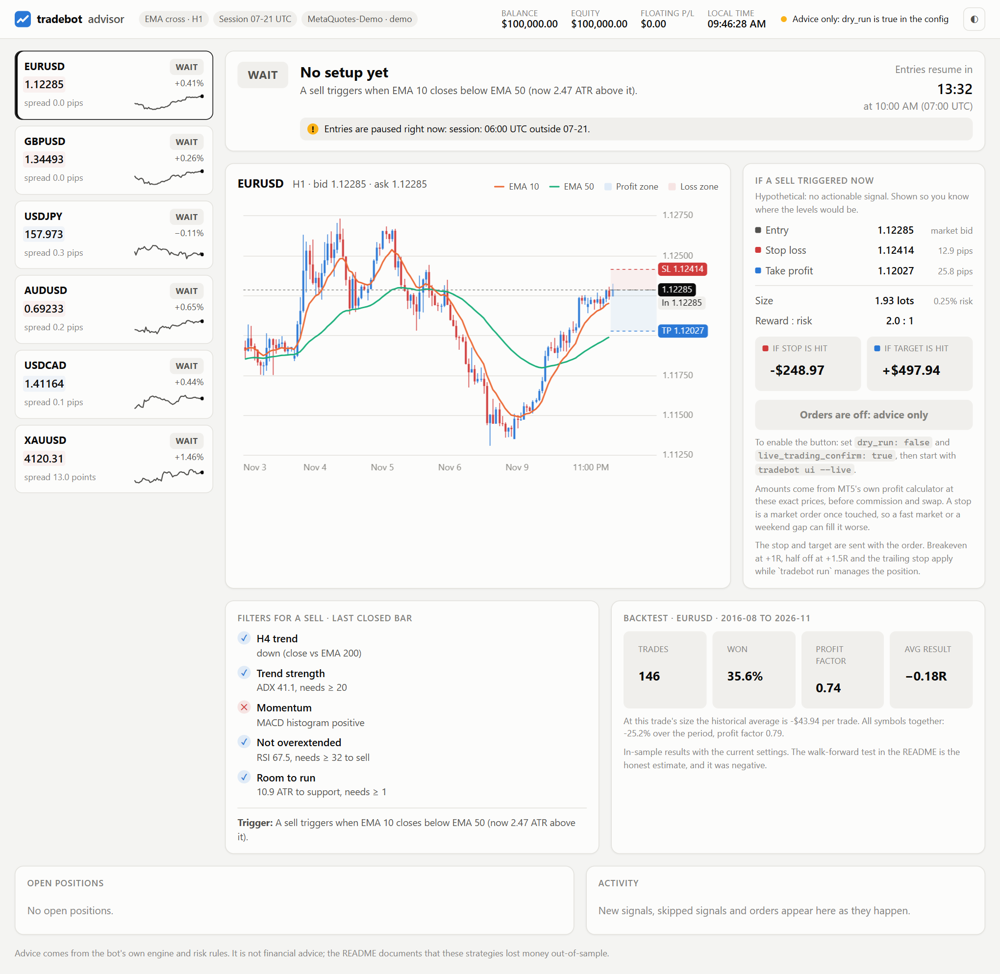
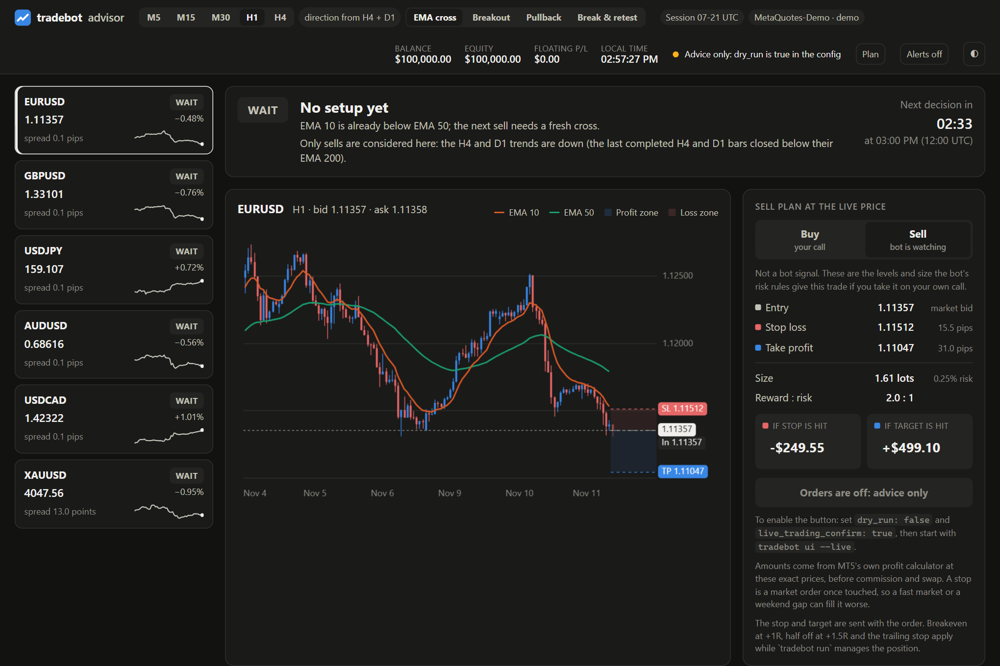
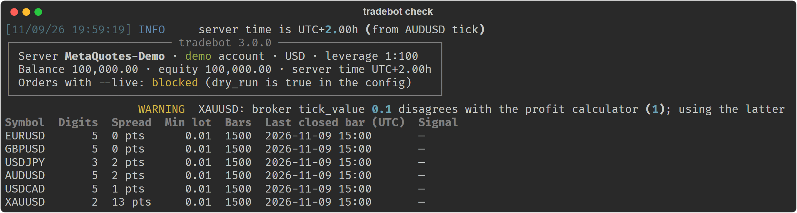
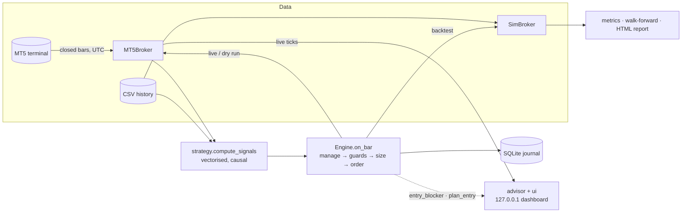
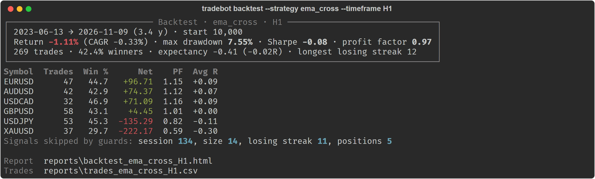
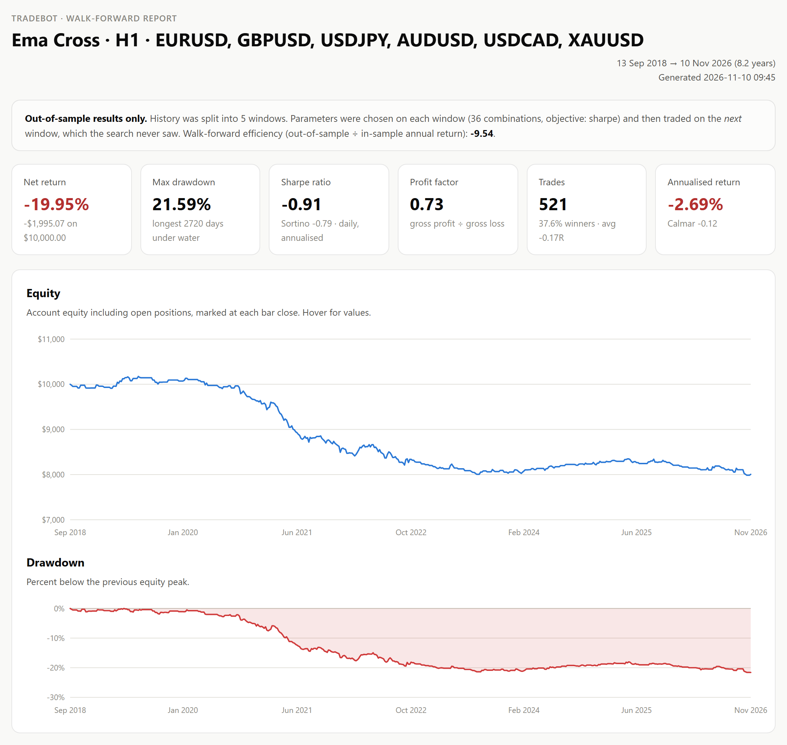
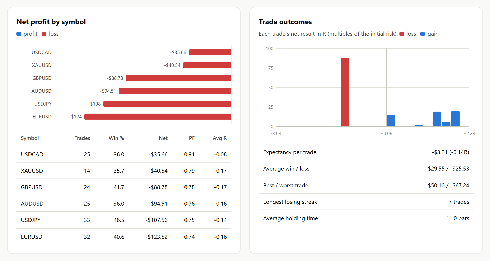
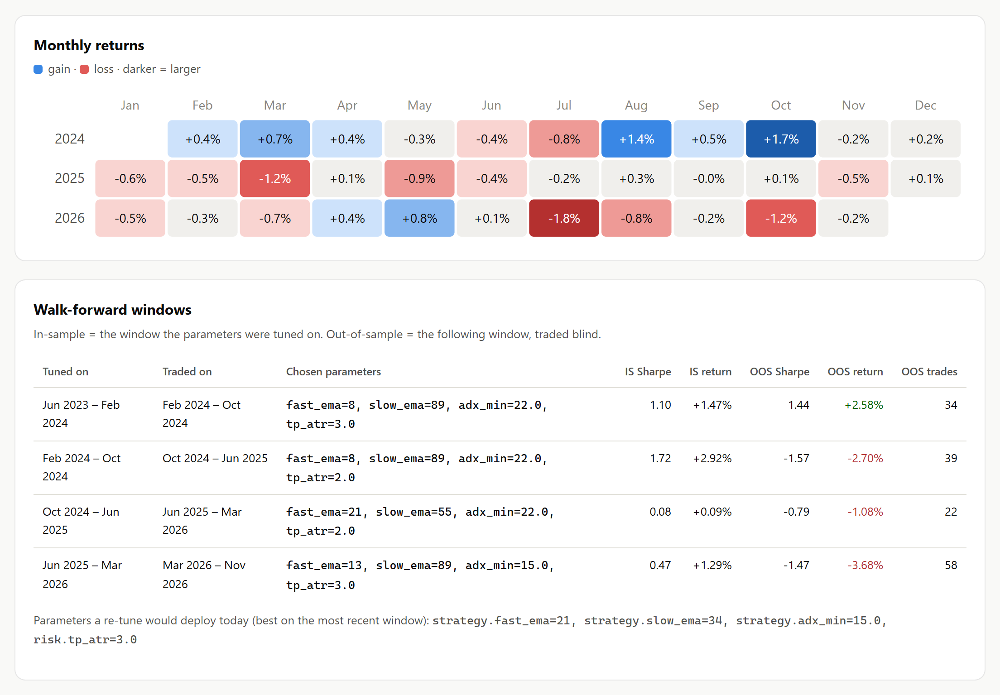
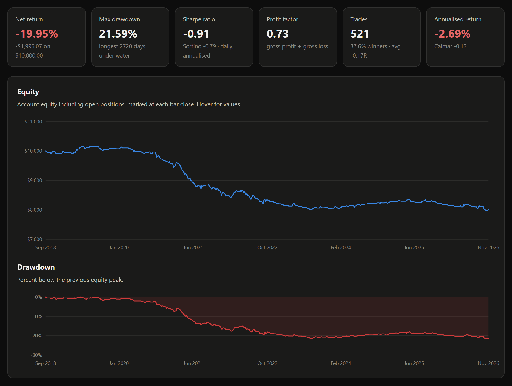
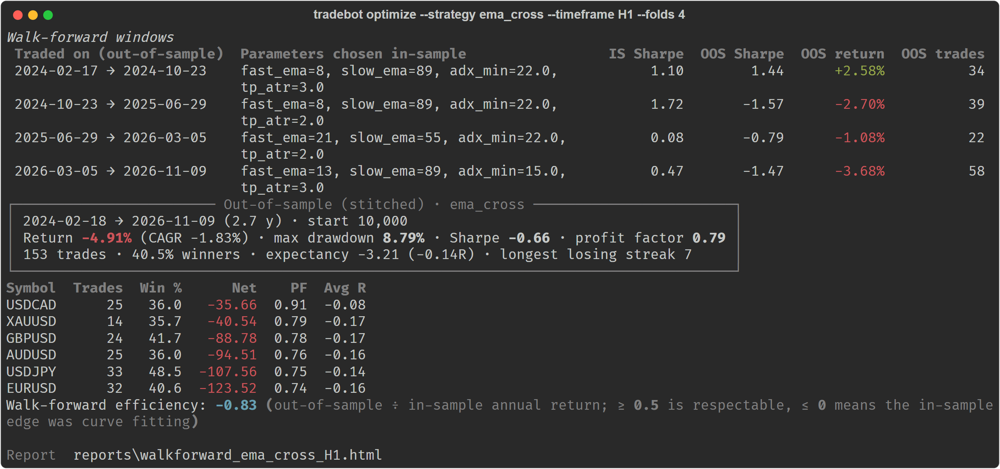

# tradebot

[](https://github.com/fahadkatonvule24/tradingBot/actions/workflows/ci.yml)


**A MetaTrader 5 trading bot built around one idea: the backtest must run the same code as live
trading.** A single decision engine sends orders through MT5 when live and through a realistic
simulated broker when backtesting, and the same engine powers a **live advisor dashboard** that
tells a person when to trade, where to put the stop and target, and how much they stand to win or
lose. Around it sit layered risk controls, three strategies, parallel walk-forward optimisation,
and HTML reports. It has been run end to end against a real MT5 terminal.



> `tradebot ui` on live MetaQuotes demo prices. No symbol has a signal on this bar, so the
> advice is **WAIT**, with the exact trigger to watch for, the filters that pass or fail, and the
> plan the bot *would* send if a sell fired now: entry, stop, target, lot size, and the money lost
> at the stop or made at the target. Orders are off because the config is in dry-run mode.

## Contents

- [What it does](#what-it-does) · [Quick start](#quick-start) · [Advisor dashboard](#advisor-dashboard) · [Safety model](#safety-model)
- [Architecture](#architecture) · [Strategies](#strategies) · [Risk and trade management](#risk-and-trade-management)
- [Backtesting model](#backtesting-model) · [Results on real data](#results-on-real-data)
- [Bugs fixed from v23](#bugs-fixed-from-v23) · [Testing](#testing) · [Limitations](#limitations-and-next-steps)

## What it does

- **Advises you live** in a browser dashboard: streaming bid/ask, BUY / SELL / BLOCKED / SKIP / WAIT per
  symbol with the reason, entry, stop-loss, take-profit, lot size, and the money at risk and to
  gain, all priced at the live quote by the same engine that trades.
- **Trades MT5** (demo or live) on closed bars, across many symbols, resolving broker suffixes
  (`EURUSD` → `EURUSDm`). All timestamps are converted from server time to UTC, including the
  broker's daylight-saving changes, which are detected from its own history.
- **Four entry setups** behind one interface: EMA crossover, Donchian breakout, trend pullback,
  and break-and-retest. They share filters for higher-timeframe trend, ADX, MACD, RSI, support/resistance and
  Fibonacci levels, all measured in ATR, so gold and forex use the same settings.
- **Sizes every trade from risk.** The volume is chosen so that hitting the stop loses
  `risk_percent` of equity. Per-lot risk comes from the terminal's own profit calculator, and the
  bot never rounds up to the broker's minimum lot.
- **Layered guards:** session hours, news blackouts, daily and weekly loss limits, losing-streak
  pause, trades per day, positions per symbol and in total, total open risk, margin, spread vs
  ATR, and a `STOP`-file kill switch.
- **Manages open trades:** partial take-profit, breakeven, ATR trailing stop, exit on an opposite
  signal, and an optional time stop. Stops only ever tighten.
- **Backtests realistically:** bid/ask spread, slippage, commission on actual lot size, gaps
  through stops, conservative intrabar fills, and multi-symbol portfolios.
- **Walk-forward optimisation** in parallel, reporting out-of-sample results only.
- **Self-contained HTML reports:** equity, drawdown, monthly returns, per-symbol results, R
  distribution, and walk-forward windows. They follow light/dark theme.
- **Journals** every order, close, stop move and rejection to SQLite.
- **Survives a terminal restart.** If MetaTrader 5 closes or restarts, the dashboard and the
  trading loop log the outage once, retry at 1, 2, 5, 10 and then every 30 seconds, and carry on
  when it is back. Startup also waits for a terminal that is still logging in.

## Quick start

```powershell
git clone https://github.com/fahadkatonvule24/tradingBot.git
cd tradingBot
python -m venv .venv; .venv\Scripts\activate
pip install -e ".[mt5]"            # the MetaTrader5 package is Windows-only

tradebot check                     # connect to the open MT5 terminal, show account, symbols, signals
tradebot ui                        # live advisor dashboard at http://127.0.0.1:8765 (advice only)
tradebot telegram                  # optional: set up alerts to your phone
tradebot run --once                # one dry-run cycle: decisions are logged, nothing is sent
tradebot run                       # keep running (dry run); Ctrl+C stops after the current cycle

tradebot fetch --bars 60000        # history to data/: trading + trend timeframes, symbol specs
tradebot backtest                  # backtest config/config.json on data/ -> reports/*.html
tradebot optimize --folds 4        # walk-forward optimisation -> out-of-sample report
tradebot journal --days 7          # what the bot did this week
```

No MetaTrader terminal? `python scripts/make_demo_data.py --out demo-data`, then run
`tradebot backtest --data demo-data --timeframe M15 --symbols EURUSD GBPUSD` to try the research tools on
synthetic data.

## Advisor dashboard

`tradebot ui` connects to the open MT5 terminal and serves a dashboard on `127.0.0.1`. For every
symbol, once a second:

| It shows | Where it comes from |
|---|---|
| Live bid / ask, spread, recent price | `symbol_info_tick` and closed bars, polled on one MT5 thread |
| **BUY / SELL**: take it now, valid until the forming bar closes | a signal on the last closed bar that passes every engine guard |
| **SKIP**: signal, but don't | the guard that blocks it (session, news, loss limit, spread, minimum lot, margin…) |
| **BLOCKED**: a trigger fired on the last bar and a strategy filter rejected it | the filter that rejected it (trend, ADX, MACD, RSI, room to S/R); the plan shows that trade in case you take it yourself, and the headline keeps the trigger visible for the next 12 bars |
| **WAIT**: no setup, and what would trigger one | the strategy's trigger, e.g. "a sell triggers when EMA 10 closes below EMA 50 (now 0.93 ATR above it)" |
| Entry, stop-loss, take-profit, lot size | `Engine.plan_entry`, the bot's own sizing, priced at the live ask (buy) or bid (sell) |
| Loss if stopped, profit at target | volume × distance × the terminal's own per-tick value |
| Filter checklist | the strategy's filters (trend, ADX, MACD, RSI, room to S/R) on the last closed bar |
| Chart | the last 120 bars plus the forming one, both EMAs, profit and loss zones, live price; hover for OHLC |
| Track record | a backtest of the current config on your downloaded history, per symbol |
| Timeframe switch | trade on M5, M15, M30, H1 or H4; the two higher timeframes that set the direction are chosen automatically (M5/M15/M30 → H1 + H4, H1 → H4 + D1, H4 → D1) and each gets its own row in the checklist |
| Setup switch | which entry the advisor watches: EMA cross, Breakout, Pullback or Break & retest. Each says what it is waiting for, with the price level where it has one ("price broke above 1.0995; a buy triggers when a bar comes back to that level and closes above it again") |
| Buy / Sell switch on the plan | the same priced plan for either side, so a trade you choose yourself gets the bot's sizing, stop and target |
| Latest trigger | the most recent entry trigger in the last 12 bars, the filter that blocked it if one did, and how far price has moved since |
| Recent signals | the last triggers across all symbols, taken or blocked, and which came first afterwards, the stop or the target, plus how often signals occur (about two a week, each live for one bar, so WAIT is the normal state) |
| Early warning | while a bar is still forming: the exact close that would fire the next trigger, and a "forming, not confirmed" notice when the current price would fire it, with whether the filters would pass or block it |
| Alerts | browser notifications, and optionally Telegram messages to your phone, when a signal fires, a filter blocks a trigger, a trigger is forming, or an order is placed |
| Open positions, activity | every position on the account (bot or manual), and advice changes as they happen |

**The advice is the bot's own decision, not a separate indicator.** `advisor.py` calls the same
`Engine.entry_blocker` and `Engine.plan_entry` that `Engine.on_bar` runs before every live or
backtest trade, so the side, lot size, stop and target on the page are exactly the order
`tradebot run --live` would send at that moment.

**Top-down analysis, on any timeframe.** With `"trend_timeframes": "auto"` (the default), the
trend filter reads the two timeframes above the one you trade and takes a trigger only when both
agree with it. Pick the trading timeframe on the dashboard, or with `--timeframe` on `ui`, `run`,
`fetch` and `backtest`; a list such as `["M30", "H4"]` sets the ladder by hand. Lower timeframes
do give more signals, and worse ones. Default parameters, nothing tuned, six instruments:

| Trading timeframe · direction from | Trades a week | Winners | Average trade | Return | Period |
|---|---:|---:|---:|---:|---|
| H1 · H4 only (the earlier default) | 1.6 | 39.3% | −0.13R | −25.3% | Aug 2016 – Nov 2026 |
| H1 · H4 + D1 | 1.2 | 37.1% | −0.18R | −26.1% | Aug 2016 – Nov 2026 |
| M30 · H1 + H4 | 2.3 | 36.5% | −0.24R | −29.9% | Oct 2021 – Nov 2026 |
| M15 · H1 + H4 | 3.4 | 34.5% | −0.27R | −26.1% | Apr 2024 – Nov 2026 |
| M5 · H1 + H4 | 6.1 | 36.3% | −0.17R | −11.1% | Dec 2025 – Nov 2026 |

Over the one window they all share (Feb – Nov 2026) the order is the same: −2.5% on H1, −8.9% on
M30, −8.2% on M15, −12.3% on M5. A second higher timeframe removes trades without improving the
ones that remain, and a 5-minute stop is only two or three pips, so the spread is a large share
of every trade. The switch is there because a person's own read is often on a lower timeframe;
it is not a way to make these triggers profitable.

**Earlier entries: breakout, pullback, break and retest.** The EMA crossover is a late entry by
design: it fires after a move is under way. The setup switch (or `--strategy`, or
`"strategy": {"name": ...}`) changes what the advisor watches: `breakout` for the bar that starts
a move, `pullback` for a dip inside a trend, and `retest` for a broken level that price comes
back to and holds. They fire five to ten times as often, and they lose too. Default parameters,
nothing tuned, six instruments, direction from the automatic two-timeframe ladder:

| Timeframe (period) | Setup | Trades a week | Winners | Average trade | Return |
|---|---|---:|---:|---:|---:|
| H1 (Aug 2016 – Nov 2026) | ema_cross | 1.2 | 37.1% | −0.18R | −26.1% |
| | breakout | 6.1 | 40.0% | −0.09R | −53.7% |
| | pullback | 6.9 | 40.3% | −0.11R | −62.5% |
| | retest | 4.5 | 39.4% | −0.10R | −47.4% |
| M30 (Oct 2021 – Nov 2026) | ema_cross | 2.3 | 36.5% | −0.24R | −29.9% |
| | breakout | 12.0 | 38.6% | −0.16R | −69.2% |
| | pullback | 10.2 | 40.0% | −0.13R | −58.0% |
| | retest | 9.2 | 38.2% | −0.17R | −63.3% |
| M15 (Apr 2024 – Nov 2026) | ema_cross | 3.4 | 34.5% | −0.27R | −26.1% |
| | breakout | 15.1 | 35.1% | −0.24R | −69.4% |
| | pullback | 17.4 | 39.2% | −0.15R | −57.6% |
| | retest | 12.0 | 36.1% | −0.22R | −58.7% |
| M5 (Dec 2025 – Nov 2026) | ema_cross | 6.1 | 36.3% | −0.17R | −11.1% |
| | breakout | 17.5 | 35.2% | −0.21R | −34.3% |
| | pullback | 20.2 | 36.5% | −0.19R | −34.8% |
| | retest | 15.3 | 35.7% | −0.17R | −26.0% |

The retest rules (20-bar level, 12 bars to come back, within 0.25 ATR, a close back in the
direction of the break) were written down before this was run and have not been changed since.
A setup that trades more often with the same negative average loses more in total, which is why
the bigger returns column belongs to the busier setups. As with the timeframe switch, this is
for following a setup you already read on the chart, with the bot's sizing and stop.

**Knowing early without acting early.** The bot decides only when a bar closes: a crossover on a
bar that is still forming can appear and vanish several times, and v23 traded those. The early
warning gives the heads-up without breaking that rule. For the EMA crossover the closing price
that produces a cross has a closed form (with α = 2/(n+1), solve α_f·c + (1−α_f)·fast = α_s·c +
(1−α_s)·slow for c); checked against 48,000 real H1 bars across the six symbols, that level
predicts the actual trigger on 100% of them. The forming notice re-runs the real signal code with
the forming bar appended at the current price, so it also says which filter would block it. It is
labelled unconfirmed everywhere, and nothing is ever traded from it.

**Alerts to your phone.** `tradebot telegram` walks through creating a Telegram bot and sends a
test message. The token and chat id live in `.env` (`TELEGRAM_BOT_TOKEN`, `TELEGRAM_CHAT_ID`),
never in the committed config. Messages go out from a background thread so a slow network cannot
delay trading; failures are logged and dropped, and the token is never written to a log.

**The bot is the risk manager; direction can be yours.** The research below found no rule that
predicts direction, and the filters block winners as readily as losers (removing the trend filter
doubles the trade count and the loss). So the dashboard does not insist on its own side: you can
switch the plan to Buy or Sell and place that trade on your own call. A manual trade needs no
strategy signal, but it still passes the trading gate and every entry guard (session, news, loss
limits, position limits, spread), is sized by the engine from your risk settings, and is sent
with its stop and target. It is journalled as manual and tagged `tradebot manual` in MT5, so your
own trades can be told apart from the bot's.

**Placing the trade from the page** is possible but off by default. The button is enabled only
when every [safety gate](#safety-model) is open and the dashboard was started with
`tradebot ui --live`. On click the server does not trust the browser: it re-reads the quote,
recomputes the advice and every guard, and sends only the engine's size for that side, with the
stop and target attached. A bot trade is refused unless it still matches the current advice. Breakeven, partial profit and trailing apply while `tradebot run` manages
the position.

**The local server is hardened, because one endpoint can place orders.** It binds to `127.0.0.1`
only, rejects foreign `Host` headers (DNS rebinding), requires a per-session token sent in a
custom header (other sites can neither read it nor send it cross-origin), refuses cross-origin
`Origin`s, and serves a strict Content-Security-Policy. All page content is inserted as text,
never as HTML, and the server uses only the standard library.



## Safety model

Real orders are sent only when **every** gate is open. `tradebot check` tells you which one is closed.

| Gate | Default | Where |
|---|---|---|
| `dry_run` | `true` | `config/config.json` |
| `live_trading_confirm` | `false` | `config/config.json` |
| `--live` flag | off | command line |
| Algo trading enabled in the terminal | your choice | MT5 → Tools → Options → Expert Advisors |
| `allow_real_account` (only for real-money accounts) | `false` | `config/config.json` |

While running live, creating a file named `STOP` in the working directory pauses new entries
immediately; open positions keep being managed. Credentials come from environment variables or a
`.env` file, never from the committed config.



> `tradebot check` against a live MetaQuotes demo terminal: server-time detection, symbol
> resolution, closed-bar signals for six instruments, and the trading gate refusing live orders
> because the config is in dry-run mode.

## Architecture



The engine only knows the `Broker` interface. Live trading passes it `MT5Broker`; the backtester
passes `SimBroker` and replays history bar by bar. **The backtest therefore exercises the same
guards, sizing and trade management as production.** v23 had a separate, simplified backtest
signal, so its results did not describe the live bot.

```
src/tradebot/
├── config.py        typed config sections, validation, per-symbol overrides
├── indicators.py    EMA, Wilder RSI/ATR/ADX, MACD (vectorised)
├── strategy.py      signals for ema_cross / breakout / pullback / retest + filters
├── engine.py        the decision procedure (live and backtest)
├── advisor.py       BUY/SELL/WAIT/SKIP advice and a priced trade plan, from the engine's own checks
├── ui/              `tradebot ui`: MT5 worker thread, hardened local server, dashboard page
├── risk.py          position sizing and portfolio risk
├── broker/          base.py (interface) · mt5.py (MetaTrader 5) · sim.py (simulation)
├── backtest.py      multi-symbol event-driven backtester
├── optimize.py      grid search + walk-forward (process pool)
├── metrics.py       Sharpe/Sortino/Calmar, drawdown, profit factor, R-multiples
├── report/          HTML report with inline SVG charts
├── live.py          trading loop and the live-trading gate
├── news.py          news-blackout calendar
├── journal.py       SQLite journal
├── notify.py        Telegram alerts (background thread, token never logged)
└── cli.py           `tradebot` command
```

## Strategies

| `strategy.name` | Entry trigger | Filters applied |
|---|---|---|
| `ema_cross` | fast EMA crosses slow EMA | trend, ADX, MACD, RSI cap, S/R room, Fibonacci (opt.) |
| `breakout` | close breaks the prior N-bar high/low | trend, ADX, MACD |
| `pullback` | fast RSI recovers from an extreme in the direction of the trend | trend, ADX, S/R room, Fibonacci (opt.) |
| `retest` | a bar closes through the prior N-bar high/low; within the next 12 bars price returns to that level and a bar closes away from it again. A close back through the level cancels the setup | trend, ADX |

The trend filter uses only **completed** higher-timeframe bars (for example the last closed H4
bar). A test asserts that every signal is causal: computing on any prefix of the data gives
exactly the same rows as computing on the full history.

## Risk and trade management

- **Stops and targets in ATR multiples** (`sl_atr`, `tp_atr`), never closer than the broker's
  stop level plus spread.
- **Sizing:** `volume = equity × risk_percent ÷ loss per lot at the stop`. If that is below the
  broker's minimum lot, the trade is **skipped**; v23 silently traded the minimum and over-risked.
- **Portfolio caps:** total open risk (counting the current stops of open positions), margin
  usage, positions per symbol and in total.
- **Loss limits** use realized P/L net of commission, swap and fees, per UTC day and ISO week. A
  losing streak pauses entries until the next UTC day.
- **Management is in R** (multiples of the initial risk): partial profit at `partial_tp_r`,
  breakeven plus a buffer at `breakeven_r`, ATR trail from `trail_start_r`. The original stop and
  volume are read back from MT5 order history, so this survives restarts.

## Backtesting model

| Aspect | Model |
|---|---|
| Prices | bars are bid (as MT5 provides); buys pay the spread, sells exit at the ask |
| Spread | the bar's recorded spread or `min_spread_points`, whichever is larger (demo feeds often record 0) |
| Execution | decisions at bar close, filled at that close ± spread/slippage |
| Stops / targets | checked on following bars' high/low; gaps fill at the open; a bar touching both counts as a stop |
| Costs | commission per lot actually traded (round trip), configurable slippage |
| Pip value | recomputed from price for USD-quoted and USD-based pairs |
| Portfolio | all symbols on one timeline sharing balance, positions and risk caps |

A 60,000-bar M15 backtest takes about 3 seconds. The accounting identity (final equity = start +
Σ trade P/L) is asserted in the tests.



The guard summary at the bottom shows how many signals each guard blocked: session hours,
position sizes below the minimum lot, the losing-streak pause, and position limits.

## Results on real data

These runs used a single H4 trend filter (`"trend_timeframes": ["H4"]`), which was the default
when they were made; the research scripts pin it. The automatic two-timeframe ladder that is
now the default is measured [under the advisor dashboard](#advisor-dashboard).

Every strategy was walk-forward tested on six instruments (EURUSD, GBPUSD, USDJPY, AUDUSD,
USDCAD, XAUUSD) using history exported from a MetaQuotes demo terminal: 60,000 H1 bars (2017 –
Nov 2026), 60,000 M15 bars (Jun 2024 – Nov 2026), and the broker's real H4 bars for the trend
filter. Each run used 4 folds and default costs (≥ 1-pip spread, $7 per lot round trip). The
out-of-sample periods are Sep 2018 – Nov 2026 for H1 (8.2 years) and Oct 2024 – Nov 2026 for M15
(2.1 years). **Every configuration tested is shown, including the losers.**

| Strategy | TF | Out-of-sample trades | Return | Max DD | Sharpe | Profit factor | Avg trade | WF efficiency |
|---|---|---:|---:|---:|---:|---:|---:|---:|
| ema_cross | H1 | 521 | **−20.0%** | 21.6% | −0.91 | 0.73 | −0.17R | −9.54 |
| breakout | H1 | 2,703 | −43.2% | 43.7% | −1.03 | 0.85 | −0.09R | −6.55 |
| pullback | H1 | 3,516 | −70.8% | 71.0% | −1.97 | 0.77 | −0.13R | n/a¹ |
| ema_cross | M15 | 362 | −20.4% | 21.0% | −2.33 | 0.63 | −0.26R | n/a¹ |
| breakout | M15 | 1,468 | −44.1% | 44.6% | −2.74 | 0.74 | −0.15R | n/a¹ |
| pullback | M15 | 2,458 | −53.3% | 54.4% | −2.83 | 0.80 | −0.12R | n/a¹ |

¹ Not even the best parameter set was profitable in-sample.

These numbers replace an earlier table computed on 3 years of H1 data with mislabelled summer
hours (see [what the advisor check found](#found-by-checking-the-advisor-against-mt5-v32)). On
that shorter window the corrected ema_cross H1 result is −6.5% out of sample (it was −4.9%).

**None of these strategies has an edge, before or after costs.** What the numbers show:

- **Costs make it worse, but they are not the whole story.** With spread, commission and slippage
  all set to zero, ema_cross with default settings still averages −0.06R per trade on H1 and
  −0.12R on M15. Costs add about 0.07R per trade on H1 and 0.13R on M15, where stops are tighter;
  that is why the default timeframe is H1 and why high-frequency variants lose fastest. (An
  earlier version of this README said zero-cost results were break-even. That was measured on
  the mislabelled data and did not survive the correction.)
- **In-sample results lie.** For ema_cross H1 the best in-sample Sharpe in any window was 0.26;
  the parameters it chose then lost in every one of the four unseen windows, one of them −16.3%.
  A negative walk-forward efficiency means the in-sample "edge" was fitted to noise. v23's
  optimizer only ever reported in-sample numbers.
- **The fill model leans conservative.** A bar that touches both stop and target counts as a
  stop. On the earlier dataset, a strategy plus its exact mirror image summed to about −0.05R per
  trade at zero cost, which is the size of that bias: small, and in the safe direction.

### Trying to improve the strategy

A structured attempt to find something better, designed so that a lucky result could not pass as
skill. The last two years (Nov 2024 – Nov 2026) were locked away as a holdout. Twelve families
were fixed in advance and walk-forward tested on the earlier data only: two triggers × three
timeframes × two exit styles ("target" = the current exits; "run" = no fixed target, trailing
stop only). The slower timeframes test whether lower relative costs help; "run" tests whether
cutting winners at a target was the problem.

| Family (2017 – Oct 2024, out-of-sample folds) | Trades | Return | Profit factor | Avg trade | t-stat |
|---|---:|---:|---:|---:|---:|
| ema_cross · H1 · run | 529 | **+3.6%** | 1.05 | +0.04R | +0.45 |
| breakout · H4 · target | 727 | −2.7% | 0.97 | −0.02R | −0.33 |
| ema_cross · H4 · target | 285 | −3.4% | 0.92 | −0.04R | −0.62 |
| ema_cross · H1 · target | 516 | −6.2% | 0.92 | −0.05R | −0.85 |
| ema_cross · D1 · target | 73 | −1.4% | 0.83 | −0.07R | −0.56 |
| ema_cross · H4 · run | 389 | −6.4% | 0.86 | −0.08R | −1.19 |
| breakout · H4 · run | 560 | −12.3% | 0.80 | −0.09R | −1.65 |
| breakout · H1 · run | 1,665 | −24.2% | 0.88 | −0.07R | −1.80 |
| breakout · H1 · target | 2,337 | −32.8% | 0.88 | −0.07R | −2.80 |
| breakout · D1 · target | 180 | −5.4% | 0.77 | −0.15R | −1.56 |
| breakout · D1 · run | 109 | −3.7% | 0.70 | −0.24R | −1.98 |
| ema_cross · D1 · run | 45 | −2.6% | 0.48 | −0.28R | −2.15 |

One family of twelve was positive, with a t-statistic of 0.45: what chance produces. It was still
taken to the holdout, once, with the parameters its last research window chose:

| Holdout, Nov 2024 – Nov 2026 | Trades | Return | Profit factor | Winners | Avg trade (after swap) |
|---|---:|---:|---:|---:|---:|
| Candidate: ema_cross · H1 · run | 77 | **−8.8%** | 0.37 | 19.5% | −0.47R |
| Current default config | 166 | −7.5% | 0.70 | 36.7% | −0.19R |

**The candidate failed and was not adopted.** Slower timeframes and letting winners run do not
rescue these triggers; none of the twelve predicts direction on these six instruments.

A second round tried three different *kinds* of idea, each tuned by walk-forward on the research
years only and then run once on the same holdout through the real engine:

| Idea | What it uses | Research (out-of-sample folds) | Holdout, Nov 2024 – Nov 2026 |
|---|---|---|---|
| **Fade** (H1) | mean reversion: trade against a move stretched ≥ 2 ATR from EMA 20 with RSI at an extreme | 334 trades, −0.10R each, t = −2.0 | 239 trades, 47.7% winners, **−4.3%**, PF 0.85 |
| **Rates** (D1) | different information: 3-month interbank rate differentials (OECD via FRED), traded monthly | 129 trades, −0.07R each, t = −0.6 | 32 trades, 34.4% winners, **−1.7%**, PF 0.58 |
| **Machine learning** (H1) | gradient boosting on the bot's 18 indicator features, predicting whether +1.5 ATR or −1.5 ATR comes first | 539 trades at its most confident, +0.00R each, t = +0.1 | 57 trades, 31.6% winners, **−5.0%**, PF 0.43 |

The machine-learning result answers "can it tell a buy from a sell?" most directly. Across
174,599 research-period bars it was right **50.4%** of the time, and 50.8% on 72,589 holdout
bars. On the 1% of bars where it was most confident it reached 55.2% in research, then 48.7%
on the holdout: the confidence was fitted noise.

Fifteen strategy variants across five kinds of idea have now been tested this way and none
predicts direction on these instruments after costs. **The default config is unchanged.**
Reproduce with `scripts/research_families.py`, `scripts/research_holdout.py` and
`scripts/research_round2.py` (`pip install -e ".[research]"`). The holdout has now been used
for four final tests, so the next idea needs fresh out-of-sample data: the honest source is
forward testing in dry-run mode, which the journal already records.

So the bot is ready to run, and the research tooling says plainly that these signal sets are not
worth trading with real money. Finding that out cheaply is the point of a backtester. New ideas
(regime filters, longer horizons, ML classifiers on the same features) can be evaluated under the
same walk-forward discipline by adding a trigger to `strategy.py`.



<details>
<summary><b>More report sections</b>: per-symbol results, R distribution, monthly returns, walk-forward windows, dark mode</summary>




</details>



## Bugs fixed from v23

v23 is kept under the [`v23` tag](https://github.com/fahadkatonvule24/tradingBot/tree/v23). Each fix has a regression test.

| v23 behaviour | Impact | Now |
|---|---|---|
| Committed `config.json` had `dry_run: false` + `live_trading_confirm: true` | cloning and running sent real orders | dry run by default, five gates |
| ADX smoothed with a running **sum** | ADX ≈ 14× too large; "trending only" filter never filtered | Wilder average, tested against a textbook implementation |
| Sizing used `symbol_info().trade_tick_value` | on MetaQuotes-Demo, XAUUSD reports 0.1 while a tick pays 1.0 → **10× intended risk on gold** | tick value from the terminal's `order_calc_profit` |
| Backtest used a different, simplified signal | backtest/optimizer results did not describe the live bot | one engine for both |
| Signals computed on the still-forming bar | crossovers could appear and vanish within a bar | closed bars only |
| Backtest commission charged on the minimum lot | costs understated ~10× | per lot traded |
| Volume below the broker minimum was rounded up | trades risked more than configured | skipped unless explicitly allowed |
| Partial take-profit remembered in memory | a restart could take it again | derived from position history |
| Dashboard requests handled only in a refresh's spare time (found in v3.6 testing) | once a refresh took over a second, the timeframe switch and the order button were never served | requests are served after every refresh |
| Forex-pip filters on every symbol | crypto/gold spreads never passed; S/R and Fibonacci meaningless | everything in ATR units, per-symbol overrides |
| Local clock for sessions, UTC for news, server time for deals | guards disagreed about "today" | UTC everywhere, server offset detected |

### Found by checking the advisor against MT5 (v3.2)

Before trusting the dashboard, every number it shows was recomputed independently against the live
terminal. The indicators matched a plain-loop reimplementation to 1e-15 and the money was within
about 1% of `order_calc_profit`, but the check also exposed these problems:

| Found | Impact | Now |
|---|---|---|
| History converted with today's server offset (UTC+2) for every bar | the broker runs New York time + 7h, so **every bar from the US daylight-saving months was labelled an hour late**: the 8:30 New York payroll spike sat in its true UTC hour on 2 of 18 summer first-Fridays (44 of 55 after the fix). Backtests applied session hours and news blackouts an hour off for seven months a year, and a bot left running over a DST weekend would have treated a forming bar as closed | the broker's clock rule is detected from its week-open pattern (`broker/clock.py`) and every bar is converted with the offset of its own date |
| Live trend filter fetched 400 H4 bars for a 200-period EMA | the EMA still carried 2% of its seed: the live H4 trend disagreed with a fully warmed EMA on up to 8% of recent bars, exactly at trend changes | 6 periods of history (seed weight 0.0006%) |
| Backtest built H4 bars from H1 starting at 00:00 UTC | MT5's H4 bars start at 17:00 New York (22:00 UTC in winter), so the backtest graded a different trend filter from the one that trades | `fetch` saves the real H4 bars and the backtest uses them; the fallback resample is anchored like the broker's |
| Profit/loss from one tick value | for USDJPY/USDCAD a pip is worth less at the target than at the stop: the plan was up to $3 off per $250 | stop and target priced by the terminal at the exact prices; sizing uses the same figure |
| Countdown to the next bar close outside trading hours | "next decision 09:00" when nothing could open before 10:00 | shows when entries resume |

After the fixes, the live path (MT5 bars, real H4 bars) and the backtest path (CSV files) agree on
the trend on every bar they share, and on the signal on every one of the last 1,300 bars of the
live window, including every bar the bot acts on. The only differences sit in the first ~150 bars
of the live window, where its indicators are still warming up. The planned loss and profit match
`order_calc_profit` to the cent.

The corrected data also changed the verdict on individual symbols: over the same 3.4 years the
default backtest went from −1.1% to **−4.7%**, and EURUSD's apparent edge (profit factor 1.15)
became a loss (0.86). It had come from the mislabelled hours.

## Testing

```bash
pip install -e ".[dev]"
pytest --cov=tradebot      # 191 tests
ruff check . && ruff format --check .
```

Tests cover indicators against textbook references, strategy causality, every engine guard and
management rule, the simulated broker's fills and accounting, walk-forward window separation,
configuration validation, the live-trading gate, and the MT5 adapter. The advisor is tested in
every state with exact prices and lot sizes. The dashboard's order path is tested to send exactly
the advised trade and to refuse when the gate is closed, the `--live` flag is missing, or the
advice has changed. The web server is tested against missing tokens, foreign Host headers and
cross-origin requests. The adapter is tested against a fake `MetaTrader5` module, so CI runs on
Linux and Windows without a terminal.

## Limitations and next steps

- **Bar-level simulation:** fills inside a bar are approximated (conservatively). Tick data would
  tighten this for scalping timeframes.
- **No regime model yet:** the strategies are classic technical rules. The results above show
  they are not enough on their own; the tooling is built to evaluate better ideas honestly.
- **News calendar is a JSON file you maintain.** An economic-calendar feed would be a natural
  addition.
- **The terminal can stall the bot.** The MetaTrader5 package blocks the whole Python process
  while the terminal is busy, for example during a large history download, so the dashboard
  freezes until the terminal answers. Download history (`tradebot fetch`) when the dashboard is
  not running.
- **One process, one terminal.** The dashboard is local by design; Telegram alerts are the only
  thing that leaves the machine, and only if you configure them.

## Disclaimer

Educational software. Trading leveraged products can lose more than you deposit. Simulated
results, including everything above, do not guarantee future performance. Test on a demo account.
