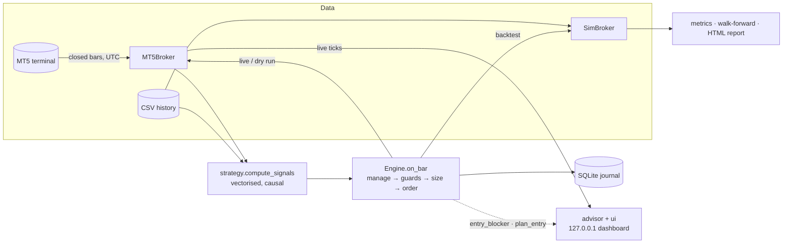

# tradebot

[](https://github.com/fahadkatonvule24/tradingBot/actions/workflows/ci.yml)


**A MetaTrader 5 trading bot built around one idea: the backtest must run the same code as live
trading.** A single decision engine sends orders through MT5 when live and through a realistic
simulated broker when backtesting, and the same engine powers a **live advisor dashboard** that
tells a person when to trade, where to put the stop and target, and how much they stand to win or
lose. Around it sit layered risk controls, three strategies, parallel walk-forward optimisation,
and HTML reports. It has been run end to end against a real MT5 terminal.


> `tradebot ui` on live MetaQuotes demo prices. No symbol has a signal on this bar, so the
> advice is **WAIT**, with the exact trigger to watch for, the filters that pass or fail, and the
> plan the bot *would* send if a sell fired now: entry, stop, target, lot size, and the money lost
> at the stop or made at the target. Orders are off because the config is in dry-run mode.

## Contents

- [What it does](#what-it-does) · [Quick start](#quick-start) · [Advisor dashboard](#advisor-dashboard) · [Safety model](#safety-model)
- [Architecture](#architecture) · [Strategies](#strategies) · [Risk and trade management](#risk-and-trade-management)
- [Backtesting model](#backtesting-model) · [Results on real data](#results-on-real-data)
- [Bugs fixed from v23](#bugs-fixed-from-v23) · [Testing](#testing) · [Limitations](#limitations-and-next-steps)

## What it does

- **Advises you live** in a browser dashboard: streaming bid/ask, BUY / SELL / WAIT / SKIP per
  symbol with the reason, entry, stop-loss, take-profit, lot size, and the money at risk and to
  gain, all priced at the live quote by the same engine that trades.
- **Trades MT5** (demo or live) on closed bars, across many symbols, resolving broker suffixes
  (`EURUSD` → `EURUSDm`). All timestamps are converted from server time to UTC.
- **Three strategies** behind one interface: EMA crossover, Donchian breakout, and trend
  pullback. They share filters for higher-timeframe trend, ADX, MACD, RSI, support/resistance and
  Fibonacci levels, all measured in ATR, so gold and forex use the same settings.
- **Sizes every trade from risk.** The volume is chosen so that hitting the stop loses
  `risk_percent` of equity. Per-lot risk comes from the terminal's own profit calculator, and the
  bot never rounds up to the broker's minimum lot.
- **Layered guards:** session hours, news blackouts, daily and weekly loss limits, losing-streak
  pause, trades per day, positions per symbol and in total, total open risk, margin, spread vs
  ATR, and a `STOP`-file kill switch.
- **Manages open trades:** partial take-profit, breakeven, ATR trailing stop, exit on an opposite
  signal, and an optional time stop. Stops only ever tighten.
- **Backtests realistically:** bid/ask spread, slippage, commission on actual lot size, gaps
  through stops, conservative intrabar fills, and multi-symbol portfolios.
- **Walk-forward optimisation** in parallel, reporting out-of-sample results only.
- **Self-contained HTML reports:** equity, drawdown, monthly returns, per-symbol results, R
  distribution, and walk-forward windows. They follow light/dark theme.
- **Journals** every order, close, stop move and rejection to SQLite.

## Quick start

```powershell
git clone https://github.com/fahadkatonvule24/tradingBot.git
cd tradingBot
python -m venv .venv; .venv\Scripts\activate
pip install -e ".[mt5]"            # the MetaTrader5 package is Windows-only

tradebot check                     # connect to the open MT5 terminal, show account, symbols, signals
tradebot ui                        # live advisor dashboard at http://127.0.0.1:8765 (advice only)
tradebot run --once                # one dry-run cycle: decisions are logged, nothing is sent
tradebot run                       # keep running (dry run); Ctrl+C stops after the current cycle

tradebot fetch --bars 60000        # download history to data/ (CSV + symbol specs)
tradebot backtest                  # backtest config/config.json on data/ -> reports/*.html
tradebot optimize --folds 4        # walk-forward optimisation -> out-of-sample report
tradebot journal --days 7          # what the bot did this week
```

No MetaTrader terminal? `python scripts/make_demo_data.py --out demo-data`, then run
`tradebot backtest --data demo-data --timeframe M15 --symbols EURUSD GBPUSD` to try the research tools on
synthetic data.

## Advisor dashboard

`tradebot ui` connects to the open MT5 terminal and serves a dashboard on `127.0.0.1`. For every
symbol, once a second:

| It shows | Where it comes from |
|---|---|
| Live bid / ask, spread, recent price | `symbol_info_tick` and closed bars, polled on one MT5 thread |
| **BUY / SELL**: take it now, valid until the forming bar closes | a signal on the last closed bar that passes every engine guard |
| **SKIP**: signal, but don't | the guard that blocks it (session, news, loss limit, spread, minimum lot, margin…) |
| **WAIT**: no setup, and what would trigger one | the strategy's trigger, e.g. "a sell triggers when EMA 10 closes below EMA 50 (now 0.93 ATR above it)" |
| Entry, stop-loss, take-profit, lot size | `Engine.plan_entry`, the bot's own sizing, priced at the live ask (buy) or bid (sell) |
| Loss if stopped, profit at target | volume × distance × the terminal's own per-tick value |
| Filter checklist | the strategy's filters (trend, ADX, MACD, RSI, room to S/R) on the last closed bar |
| Chart | the last 120 bars plus the forming one, both EMAs, profit and loss zones, live price; hover for OHLC |
| Track record | a backtest of the current config on your downloaded history, per symbol |
| Open positions, activity | every position on the account (bot or manual), and advice changes as they happen |

**The advice is the bot's own decision, not a separate indicator.** `advisor.py` calls the same
`Engine.entry_blocker` and `Engine.plan_entry` that `Engine.on_bar` runs before every live or
backtest trade, so the side, lot size, stop and target on the page are exactly the order
`tradebot run --live` would send at that moment.

**Placing the trade from the page** is possible but off by default. The button is enabled only
when every [safety gate](#safety-model) is open and the dashboard was started with
`tradebot ui --live`. On click the server does not trust the browser: it re-reads the quote,
recomputes the advice and every guard, and sends only the advised side and size, with the stop
and target attached. Breakeven, partial profit and trailing apply while `tradebot run` manages
the position.

**The local server is hardened, because one endpoint can place orders.** It binds to `127.0.0.1`
only, rejects foreign `Host` headers (DNS rebinding), requires a per-session token sent in a
custom header (other sites can neither read it nor send it cross-origin), refuses cross-origin
`Origin`s, and serves a strict Content-Security-Policy. All page content is inserted as text,
never as HTML, and the server uses only the standard library.


## Safety model

Real orders are sent only when **every** gate is open. `tradebot check` tells you which one is closed.

| Gate | Default | Where |
|---|---|---|
| `dry_run` | `true` | `config/config.json` |
| `live_trading_confirm` | `false` | `config/config.json` |
| `--live` flag | off | command line |
| Algo trading enabled in the terminal | your choice | MT5 → Tools → Options → Expert Advisors |
| `allow_real_account` (only for real-money accounts) | `false` | `config/config.json` |

While running live, creating a file named `STOP` in the working directory pauses new entries
immediately; open positions keep being managed. Credentials come from environment variables or a
`.env` file, never from the committed config.


> `tradebot check` against a live MetaQuotes demo terminal: server-time detection, symbol
> resolution, closed-bar signals for six instruments, and the trading gate refusing live orders
> because the config is in dry-run mode.

## Architecture



The engine only knows the `Broker` interface. Live trading passes it `MT5Broker`; the backtester
passes `SimBroker` and replays history bar by bar. **The backtest therefore exercises the same
guards, sizing and trade management as production.** v23 had a separate, simplified backtest
signal, so its results did not describe the live bot.

```
src/tradebot/
├── config.py        typed config sections, validation, per-symbol overrides
├── indicators.py    EMA, Wilder RSI/ATR/ADX, MACD (vectorised)
├── strategy.py      signals for ema_cross / breakout / pullback + shared filters
├── engine.py        the decision procedure (live and backtest)
├── advisor.py       BUY/SELL/WAIT/SKIP advice and a priced trade plan, from the engine's own checks
├── ui/              `tradebot ui`: MT5 worker thread, hardened local server, dashboard page
├── risk.py          position sizing and portfolio risk
├── broker/          base.py (interface) · mt5.py (MetaTrader 5) · sim.py (simulation)
├── backtest.py      multi-symbol event-driven backtester
├── optimize.py      grid search + walk-forward (process pool)
├── metrics.py       Sharpe/Sortino/Calmar, drawdown, profit factor, R-multiples
├── report/          HTML report with inline SVG charts
├── live.py          trading loop and the live-trading gate
├── news.py          news-blackout calendar
├── journal.py       SQLite journal
└── cli.py           `tradebot` command
```

## Strategies

| `strategy.name` | Entry trigger | Filters applied |
|---|---|---|
| `ema_cross` | fast EMA crosses slow EMA | trend, ADX, MACD, RSI cap, S/R room, Fibonacci (opt.) |
| `breakout` | close breaks the prior N-bar high/low | trend, ADX, MACD |
| `pullback` | fast RSI recovers from an extreme in the direction of the trend | trend, ADX, S/R room, Fibonacci (opt.) |

The trend filter uses only **completed** higher-timeframe bars (for example the last closed H4
bar). A test asserts that every signal is causal: computing on any prefix of the data gives
exactly the same rows as computing on the full history.

## Risk and trade management

- **Stops and targets in ATR multiples** (`sl_atr`, `tp_atr`), never closer than the broker's
  stop level plus spread.
- **Sizing:** `volume = equity × risk_percent ÷ loss per lot at the stop`. If that is below the
  broker's minimum lot, the trade is **skipped**; v23 silently traded the minimum and over-risked.
- **Portfolio caps:** total open risk (counting the current stops of open positions), margin
  usage, positions per symbol and in total.
- **Loss limits** use realized P/L net of commission, swap and fees, per UTC day and ISO week. A
  losing streak pauses entries until the next UTC day.
- **Management is in R** (multiples of the initial risk): partial profit at `partial_tp_r`,
  breakeven plus a buffer at `breakeven_r`, ATR trail from `trail_start_r`. The original stop and
  volume are read back from MT5 order history, so this survives restarts.

## Backtesting model

| Aspect | Model |
|---|---|
| Prices | bars are bid (as MT5 provides); buys pay the spread, sells exit at the ask |
| Spread | the bar's recorded spread or `min_spread_points`, whichever is larger (demo feeds often record 0) |
| Execution | decisions at bar close, filled at that close ± spread/slippage |
| Stops / targets | checked on following bars' high/low; gaps fill at the open; a bar touching both counts as a stop |
| Costs | commission per lot actually traded (round trip), configurable slippage |
| Pip value | recomputed from price for USD-quoted and USD-based pairs |
| Portfolio | all symbols on one timeline sharing balance, positions and risk caps |

A 60,000-bar M15 backtest takes about 3 seconds. The accounting identity (final equity = start +
Σ trade P/L) is asserted in the tests.


The guard summary at the bottom shows how many signals each guard blocked: session hours,
position sizes below the minimum lot, the losing-streak pause, and position limits.

## Results on real data

Every strategy was walk-forward tested on six instruments (EURUSD, GBPUSD, USDJPY, AUDUSD,
USDCAD, XAUUSD) using history exported from a MetaQuotes demo terminal: 60,000 M15 bars (Jun 2024 –
Nov 2026) and 20,000 H1 bars (Aug 2023 – Nov 2026). Each run used 4 folds and default costs (≥ 1-pip
spread, $7 per lot round trip). **Every configuration tested is shown, including the losers.**

| Strategy | TF | Out-of-sample trades | Return | Max DD | Sharpe | Profit factor | Avg trade | WF efficiency |
|---|---|---:|---:|---:|---:|---:|---:|---:|
| ema_cross | H1 | 153 | **−4.9%** | 8.8% | −0.66 | 0.79 | −0.14R | −0.83 |
| breakout | H1 | 782 | −18.2% | 19.4% | −1.19 | 0.81 | −0.10R | −4.19 |
| pullback | H1 | 1,036 | −31.1% | 31.9% | −1.90 | 0.76 | −0.15R | n/a¹ |
| ema_cross | M15 | 360 | −16.6% | 18.9% | −1.91 | 0.69 | −0.21R | n/a¹ |
| breakout | M15 | 1,705 | −42.4% | 43.7% | −2.51 | 0.78 | −0.13R | n/a¹ |
| pullback | M15 | 2,273 | −46.3% | 47.7% | −2.36 | 0.82 | −0.11R | n/a¹ |

¹ Not even the best parameter set was profitable in-sample.

**None of these strategies has an edge that survives costs out of sample.** What the numbers show:

- **Costs are the whole story.** Re-running with zero costs moves results to roughly break-even
  (ema_cross H1: +0.02R per trade; M15: −0.12R). Costs are ~0.12R per trade on M15 but ~0.04R on
  H1, because the H1 stop is wider. That is why the default timeframe is now H1, and why
  high-frequency variants lose fastest.
- **In-sample results lie.** ema_cross H1 reached an in-sample Sharpe of 1.72 in one window and
  then −1.57 on the next, unseen window. A negative walk-forward efficiency means the in-sample
  "edge" was fitted to noise. v23's optimizer only ever reported in-sample numbers.
- **The simulator has been sanity-checked.** At zero cost, a strategy plus its exact mirror image
  sums to about −0.05R per trade. That is the deliberate conservatism of the fill model (a bar
  touching both stop and target counts as a stop), small and in the safe direction.

So the bot is ready to run, and the research tooling says plainly that these signal sets are not
worth trading with real money. Finding that out cheaply is the point of a backtester. New ideas
(regime filters, longer horizons, ML classifiers on the same features) can be evaluated under the
same walk-forward discipline by adding a trigger to `strategy.py`.


<details>
<summary><b>More report sections</b>: per-symbol results, R distribution, monthly returns, walk-forward windows, dark mode</summary>


</details>


## Bugs fixed from v23

v23 is kept under the [`v23` tag](https://github.com/fahadkatonvule24/tradingBot/tree/v23). Each fix has a regression test.

| v23 behaviour | Impact | Now |
|---|---|---|
| Committed `config.json` had `dry_run: false` + `live_trading_confirm: true` | cloning and running sent real orders | dry run by default, five gates |
| ADX smoothed with a running **sum** | ADX ≈ 14× too large; "trending only" filter never filtered | Wilder average, tested against a textbook implementation |
| Sizing used `symbol_info().trade_tick_value` | on MetaQuotes-Demo, XAUUSD reports 0.1 while a tick pays 1.0 → **10× intended risk on gold** | tick value from the terminal's `order_calc_profit` |
| Backtest used a different, simplified signal | backtest/optimizer results did not describe the live bot | one engine for both |
| Signals computed on the still-forming bar | crossovers could appear and vanish within a bar | closed bars only |
| Backtest commission charged on the minimum lot | costs understated ~10× | per lot traded |
| Volume below the broker minimum was rounded up | trades risked more than configured | skipped unless explicitly allowed |
| Partial take-profit remembered in memory | a restart could take it again | derived from position history |
| Forex-pip filters on every symbol | crypto/gold spreads never passed; S/R and Fibonacci meaningless | everything in ATR units, per-symbol overrides |
| Local clock for sessions, UTC for news, server time for deals | guards disagreed about "today" | UTC everywhere, server offset detected |

## Testing

```bash
pip install -e ".[dev]"
pytest --cov=tradebot      # 105 tests
ruff check . && ruff format --check .
```

Tests cover indicators against textbook references, strategy causality, every engine guard and
management rule, the simulated broker's fills and accounting, walk-forward window separation,
configuration validation, the live-trading gate, and the MT5 adapter. The advisor is tested in
every state with exact prices and lot sizes. The dashboard's order path is tested to send exactly
the advised trade and to refuse when the gate is closed, the `--live` flag is missing, or the
advice has changed. The web server is tested against missing tokens, foreign Host headers and
cross-origin requests. The adapter is tested against a fake `MetaTrader5` module, so CI runs on
Linux and Windows without a terminal.

## Limitations and next steps

- **Bar-level simulation:** fills inside a bar are approximated (conservatively). Tick data would
  tighten this for scalping timeframes.
- **No regime model yet:** the strategies are classic technical rules. The results above show
  they are not enough on their own; the tooling is built to evaluate better ideas honestly.
- **News calendar is a JSON file you maintain.** An economic-calendar feed would be a natural
  addition.
- **One process, one terminal.** The dashboard is local by design. Alerts (Telegram/email) when
  advice turns to BUY or SELL would slot into the monitor's activity feed.

## Disclaimer

Educational software. Trading leveraged products can lose more than you deposit. Simulated
results, including everything above, do not guarantee future performance. Test on a demo account.
