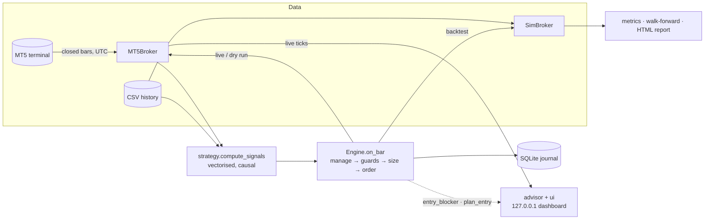

# tradebot

[](https://github.com/fahadkatonvule24/tradingBot/actions/workflows/ci.yml)


**A MetaTrader 5 trading bot built around one idea: the backtest must run the same code as live
trading.** A single decision engine sends orders through MT5 when live and through a realistic
simulated broker when backtesting, and the same engine powers a **live advisor dashboard** that
tells a person when to trade, where to put the stop and target, and how much they stand to win or
lose. Around it sit layered risk controls, three strategies, parallel walk-forward optimisation,
and HTML reports. It has been run end to end against a real MT5 terminal.


> `tradebot ui` on live MetaQuotes demo prices. No symbol has a signal on this bar, so the
> advice is **WAIT**, with the exact trigger to watch for, the filters that pass or fail, and the
> plan the bot *would* send if a sell fired now: entry, stop, target, lot size, and the money lost
> at the stop or made at the target. Orders are off because the config is in dry-run mode.

## Contents

- [What it does](#what-it-does) · [Quick start](#quick-start) · [Advisor dashboard](#advisor-dashboard) · [Safety model](#safety-model)
- [Architecture](#architecture) · [Strategies](#strategies) · [Risk and trade management](#risk-and-trade-management) · [Trading principles](#trading-principles)
- [Backtesting model](#backtesting-model) · [Results on real data](#results-on-real-data)
- [Bugs fixed from v23](#bugs-fixed-from-v23) · [Testing](#testing) · [Limitations](#limitations-and-next-steps)

## What it does

- **Advises you live** in a browser dashboard: streaming bid/ask, BUY / SELL / BLOCKED / SKIP / WAIT per
  symbol with the reason, entry, stop-loss, take-profit, lot size, and the money at risk and to
  gain, all priced at the live quote by the same engine that trades.
- **Trades MT5** (demo or live) on closed bars, across many symbols, resolving broker suffixes
  (`EURUSD` → `EURUSDm`). All timestamps are converted from server time to UTC, including the
  broker's daylight-saving changes, which are detected from its own history.
- **Four entry setups** behind one interface: EMA crossover, Donchian breakout, trend pullback,
  and break-and-retest. They share filters for higher-timeframe trend, ADX, MACD, RSI, support/resistance and
  Fibonacci levels, all measured in ATR, so gold and forex use the same settings.
- **Sizes every trade from risk.** The volume is chosen so that hitting the stop loses
  `risk_percent` of equity. Per-lot risk comes from the terminal's own profit calculator, and the
  bot never rounds up to the broker's minimum lot.
- **Layered guards:** session hours, news blackouts, daily and weekly loss limits, a drawdown
  limit, losing-streak pause, trades per day, positions per symbol and in total, total open risk,
  margin, spread vs ATR, and a `STOP`-file kill switch.
- **Writes its own trading plan.** `tradebot plan` states every rule in plain words, generated
  from the settings the engine reads, so the written plan and the executed plan cannot differ.
  `tradebot review` then reports closed trades in R and compares the bot's signals with trades
  placed by hand.
- **Manages open trades:** partial take-profit, breakeven, ATR trailing stop, exit on an opposite
  signal, and an optional time stop. Stops only ever tighten.
- **Backtests realistically:** bid/ask spread, slippage, commission on actual lot size, gaps
  through stops, conservative intrabar fills, and multi-symbol portfolios.
- **Walk-forward optimisation** in parallel, reporting out-of-sample results only.
- **Self-contained HTML reports:** equity, drawdown, monthly returns, per-symbol results, R
  distribution, and walk-forward windows. They follow light/dark theme.
- **Journals** every order, close, stop move and rejection to SQLite.
- **Survives a terminal restart.** If MetaTrader 5 closes or restarts, the dashboard and the
  trading loop log the outage once, retry at 1, 2, 5, 10 and then every 30 seconds, and carry on
  when it is back. Startup also waits for a terminal that is still logging in.

## Quick start

```powershell
git clone https://github.com/fahadkatonvule24/tradingBot.git
cd tradingBot
python -m venv .venv; .venv\Scripts\activate
pip install -e ".[mt5]"            # the MetaTrader5 package is Windows-only

tradebot check                     # connect to the open MT5 terminal, show account, symbols, signals
tradebot ui                        # live advisor dashboard at http://127.0.0.1:8765 (advice only)
tradebot telegram                  # optional: set up alerts to your phone
tradebot run --once                # one dry-run cycle: decisions are logged, nothing is sent
tradebot run                       # keep running (dry run); Ctrl+C stops after the current cycle

tradebot fetch --bars 60000        # history to data/: trading + trend timeframes, tick volume, symbol specs
tradebot backtest                  # backtest config/config.json on data/ -> reports/*.html
tradebot optimize --folds 4        # walk-forward optimisation -> out-of-sample report
tradebot journal --days 7          # what the bot did this week
tradebot plan --out PLAN.md        # the written trading plan, generated from the config
tradebot review --days 30          # closed trades in R: the bot's signals against your own calls
```

No MetaTrader terminal? `python scripts/make_demo_data.py --out demo-data`, then run
`tradebot backtest --data demo-data --timeframe M15 --symbols EURUSD GBPUSD` to try the research tools on
synthetic data.

## Advisor dashboard

`tradebot ui` connects to the open MT5 terminal and serves a dashboard on `127.0.0.1`. For every
symbol, once a second:

| It shows | Where it comes from |
|---|---|
| Live bid / ask, spread, recent price | `symbol_info_tick` and closed bars, polled on one MT5 thread |
| **BUY / SELL**: take it now, valid until the forming bar closes | a signal on the last closed bar that passes every engine guard |
| **SKIP**: signal, but don't | the guard that blocks it (session, news, loss limit, spread, minimum lot, margin…) |
| **BLOCKED**: a trigger fired on the last bar and a strategy filter rejected it | the filter that rejected it (trend, ADX, MACD, RSI, room to S/R); the plan shows that trade in case you take it yourself, and the headline keeps the trigger visible for the next 12 bars |
| **WAIT**: no setup, and what would trigger one | the strategy's trigger, e.g. "a sell triggers when EMA 10 closes below EMA 50 (now 0.93 ATR above it)" |
| Entry, stop-loss, take-profit, lot size | `Engine.plan_entry`, the bot's own sizing, priced at the live ask (buy) or bid (sell) |
| Loss if stopped, profit at target | volume × distance × the terminal's own per-tick value |
| Filter checklist | the strategy's filters (trend, ADX, MACD, RSI, room to S/R) on the last closed bar |
| Chart | the last 120 bars plus the forming one, both EMAs, profit and loss zones, live price; hover for OHLC |
| Track record | a backtest of the current config on your downloaded history, per symbol |
| Timeframe switch | trade on M5, M15, M30, H1 or H4; the two higher timeframes that set the direction are chosen automatically (M5/M15/M30 → H1 + H4, H1 → H4 + D1, H4 → D1) and each gets its own row in the checklist |
| Setup switch | which entry the advisor watches: EMA cross, Breakout, Pullback or Break & retest. Each says what it is waiting for, with the price level where it has one ("price broke above 1.0995; a buy triggers when a bar comes back to that level and closes above it again") |
| Buy / Sell switch on the plan | the same priced plan for either side, so a trade you choose yourself gets the bot's sizing, stop and target |
| Latest trigger | the most recent entry trigger in the last 12 bars, the filter that blocked it if one did, and how far price has moved since |
| Recent signals | the last triggers across all symbols, taken or blocked, and which came first afterwards, the stop or the target, plus how often signals occur (about two a week, each live for one bar, so WAIT is the normal state) |
| Early warning | while a bar is still forming: the exact close that would fire the next trigger, and a "forming, not confirmed" notice when the current price would fire it, with whether the filters would pass or block it |
| Risk limits | how much of each account limit is used: today's and this week's result against the loss limits, drawdown, losses in a row, entries today, open risk. The tile of a limit that is hit turns red and the card says entries are stopped |
| Plan | the written trading plan for the setup and timeframe on screen, with what those rules measured on your stored history |
| Reversal warning | for every open position on a watched instrument, the bot's or one you opened by hand: the signs that the market has turned against it since it opened. One sign is a warning; an opposite signal or two signs together is "get out". Shown in a strip across the top, on the instrument's card, under the position, in the tab title and in the alerts. A sign the bar still forming would add is shown as "forming, not confirmed" |
| Alerts | browser notifications, and optionally Telegram messages to your phone, when a signal fires, a filter blocks a trigger, a trigger is forming, an order is placed, or the market turns against an open position |
| Open positions, activity | every position on the account (bot or manual), and advice changes as they happen |

**The advice is the bot's own decision, not a separate indicator.** `advisor.py` calls the same
`Engine.entry_blocker` and `Engine.plan_entry` that `Engine.on_bar` runs before every live or
backtest trade, so the side, lot size, stop and target on the page are exactly the order
`tradebot run --live` would send at that moment.

**Top-down analysis, on any timeframe.** With `"trend_timeframes": "auto"` (the default), the
trend filter reads the two timeframes above the one you trade and takes a trigger only when both
agree with it. Pick the trading timeframe on the dashboard, or with `--timeframe` on `ui`, `run`,
`fetch` and `backtest`; a list such as `["M30", "H4"]` sets the ladder by hand. Lower timeframes
do give more signals, and worse ones. Default parameters, nothing tuned, six instruments:

| Trading timeframe · direction from | Trades a week | Winners | Average trade | Return | Period |
|---|---:|---:|---:|---:|---|
| H1 · H4 only (the earlier default) | 1.6 | 39.3% | −0.13R | −25.3% | Aug 2016 – Nov 2026 |
| H1 · H4 + D1 | 1.2 | 37.1% | −0.18R | −26.1% | Aug 2016 – Nov 2026 |
| M30 · H1 + H4 | 2.3 | 36.5% | −0.24R | −29.9% | Oct 2021 – Nov 2026 |
| M15 · H1 + H4 | 3.4 | 34.5% | −0.27R | −26.1% | Apr 2024 – Nov 2026 |
| M5 · H1 + H4 | 6.1 | 36.3% | −0.17R | −11.1% | Dec 2025 – Nov 2026 |

Over the one window they all share (Feb – Nov 2026) the order is the same: −2.5% on H1, −8.9% on
M30, −8.2% on M15, −12.3% on M5. A second higher timeframe removes trades without improving the
ones that remain, and a 5-minute stop is only two or three pips, so the spread is a large share
of every trade. The switch is there because a person's own read is often on a lower timeframe;
it is not a way to make these triggers profitable.

**Earlier entries: breakout, pullback, break and retest.** The EMA crossover is a late entry by
design: it fires after a move is under way. The setup switch (or `--strategy`, or
`"strategy": {"name": ...}`) changes what the advisor watches: `breakout` for the bar that starts
a move, `pullback` for a dip inside a trend, and `retest` for a broken level that price comes
back to and holds. They fire four to ten times as often, and they lose too. Default parameters,
nothing tuned, six instruments, direction from the automatic two-timeframe ladder:

| Timeframe (period) | Setup | Trades a week | Winners | Average trade | Return |
|---|---|---:|---:|---:|---:|
| H1 (Aug 2016 – Nov 2026) | ema_cross | 1.2 | 37.1% | −0.18R | −26.1% |
| | breakout | 4.7 | 42.1% | −0.04R | −26.5% |
| | pullback | 6.9 | 40.3% | −0.11R | −62.5% |
| | retest | 4.5 | 39.4% | −0.10R | −47.4% |
| M30 (Oct 2021 – Nov 2026) | ema_cross | 2.3 | 36.5% | −0.24R | −29.9% |
| | breakout | 9.3 | 39.5% | −0.13R | −54.2% |
| | pullback | 10.2 | 40.0% | −0.13R | −58.0% |
| | retest | 9.2 | 38.2% | −0.17R | −63.3% |
| M15 (Apr 2024 – Nov 2026) | ema_cross | 3.4 | 34.5% | −0.27R | −26.1% |
| | breakout | 12.0 | 36.4% | −0.19R | −51.8% |
| | pullback | 17.4 | 39.2% | −0.15R | −57.6% |
| | retest | 12.0 | 36.1% | −0.22R | −58.7% |
| M5 (Dec 2025 – Nov 2026) | ema_cross | 6.1 | 36.3% | −0.17R | −11.1% |
| | breakout | 15.1 | 36.7% | −0.16R | −25.5% |
| | pullback | 20.2 | 36.5% | −0.19R | −34.8% |
| | retest | 15.3 | 35.7% | −0.17R | −26.0% |

The retest rules (20-bar level, 12 bars to come back, within 0.25 ATR, a close back in the
direction of the break) were written down before this was run and have not been changed since.
A setup that trades more often with the same negative average loses more in total, which is why
the bigger returns column belongs to the busier setups. As with the timeframe switch, this is
for following a setup you already read on the chart, with the bot's sizing and stop.

**False breakouts.** On this history they are the normal case: 60% of H1 breakouts (65% on M15)
close back through the level within 12 bars, and after a breakout price moves one ATR further
in the same direction first only 48% of the time. Trading with the higher-timeframe trend makes
no difference to that (60.1% against 60.6%). Five ways of dealing with it were written down and
run once each, on six instruments with default risk settings:

| Approach | H1 trades a week | H1 average trade | M15 average trade |
|---|---:|---:|---:|
| Any close through the level (the rule until v3.7) | 6.1 | −0.09R | −0.24R |
| **Decisive close:** at least 0.25 ATR beyond the level | 4.7 | −0.04R | −0.19R |
| Two closes: enter only if the next bar also closes beyond it | 5.7 | −0.06R | −0.21R |
| Break and retest | 4.5 | −0.10R | −0.22R |
| Trade against the failed break | 3.7 | −0.13R | −0.11R |

The decisive close is now the breakout rule (`"breakout_min_atr": 0.25`; `0` restores the old
one). It was the best of five, so part of its lead may be luck; on M30 and M5, which were not
part of the comparison, it improved the average trade from −0.16R to −0.13R and from −0.21R to
−0.16R. It is still a losing rule. The first close through the level must itself be decisive: a
marginal poke followed by a strong bar is not treated as a fresh break.

Because most breaks fail, the advisor says so when one does. For the breakout and retest setups
a broken level is watched for 12 bars, and a close back through it puts "Break failed" on the
card and the watchlist, in the activity feed, and in the Telegram and browser alerts. If a later
bar closes beyond the level again, the card calls the break unsettled instead. Stops are
unchanged: 1.5 ATR, moved to breakeven at +1R, already bound what a false break costs.

**Knowing early without acting early.** The bot decides only when a bar closes: a crossover on a
bar that is still forming can appear and vanish several times, and v23 traded those. The early
warning gives the heads-up without breaking that rule. For the EMA crossover the closing price
that produces a cross has a closed form (with α = 2/(n+1), solve α_f·c + (1−α_f)·fast = α_s·c +
(1−α_s)·slow for c); checked against 48,000 real H1 bars across the six symbols, that level
predicts the actual trigger on 100% of them. The forming notice re-runs the real signal code with
the forming bar appended at the current price, so it also says which filter would block it. It is
labelled unconfirmed everywhere, and nothing is ever traded from it.

**Alerts to your phone.** `tradebot telegram` walks through creating a Telegram bot and sends a
test message. The token and chat id live in `.env` (`TELEGRAM_BOT_TOKEN`, `TELEGRAM_CHAT_ID`),
never in the committed config. Messages go out from a background thread so a slow network cannot
delay trading; failures are logged and dropped, and the token is never written to a log.

**The bot is the risk manager; direction can be yours.** The research below found no rule that
predicts direction, and the filters block winners as readily as losers (removing the trend filter
doubles the trade count and the loss). So the dashboard does not insist on its own side: you can
switch the plan to Buy or Sell and place that trade on your own call. A manual trade needs no
strategy signal, but it still passes the trading gate and every entry guard (session, news, loss
limits, position limits, spread), is sized by the engine from your risk settings, and is sent
with its stop and target. It is journalled as manual and tagged `tradebot manual` in MT5, so your
own trades can be told apart from the bot's.

**Placing the trade from the page** is possible but off by default. The button is enabled only
when every [safety gate](#safety-model) is open and the dashboard was started with
`tradebot ui --live`. On click the server does not trust the browser: it re-reads the quote,
recomputes the advice and every guard, and sends only the engine's size for that side, with the
stop and target attached. A bot trade is refused unless it still matches the current advice. Breakeven, partial profit and trailing apply while `tradebot run` manages
the position.

**The local server is hardened, because one endpoint can place orders.** It binds to `127.0.0.1`
only, rejects foreign `Host` headers (DNS rebinding), requires a per-session token sent in a
custom header (other sites can neither read it nor send it cross-origin), refuses cross-origin
`Origin`s, and serves a strict Content-Security-Policy. All page content is inserted as text,
never as HTML, and the server uses only the standard library.


## Safety model

Real orders are sent only when **every** gate is open. `tradebot check` tells you which one is closed.

| Gate | Default | Where |
|---|---|---|
| `dry_run` | `true` | `config/config.json` |
| `live_trading_confirm` | `false` | `config/config.json` |
| `--live` flag | off | command line |
| Algo trading enabled in the terminal | your choice | MT5 → Tools → Options → Expert Advisors |
| `allow_real_account` (only for real-money accounts) | `false` | `config/config.json` |

While running live, creating a file named `STOP` in the working directory pauses new entries
immediately; open positions keep being managed. Credentials come from environment variables or a
`.env` file, never from the committed config.


> `tradebot check` against a live MetaQuotes demo terminal: server-time detection, symbol
> resolution, closed-bar signals for six instruments, and the trading gate refusing live orders
> because the config is in dry-run mode.

## Architecture



The engine only knows the `Broker` interface. Live trading passes it `MT5Broker`; the backtester
passes `SimBroker` and replays history bar by bar. **The backtest therefore exercises the same
guards, sizing and trade management as production.** v23 had a separate, simplified backtest
signal, so its results did not describe the live bot.

```
src/tradebot/
├── config.py        typed config sections, validation, per-symbol overrides
├── indicators.py    EMA, Wilder RSI/ATR/ADX, MACD (vectorised)
├── strategy.py      signals for ema_cross / breakout / pullback / retest + filters
├── engine.py        the decision procedure (live and backtest)
├── advisor.py       BUY/SELL/WAIT/SKIP advice and a priced trade plan, from the engine's own checks
├── ui/              `tradebot ui`: MT5 worker thread, hardened local server, dashboard page
├── risk.py          position sizing, portfolio risk, drawdown
├── plan.py          the written trading plan, generated from the config
├── review.py        closed trades in R, bot signals against manual trades
├── reversal.py      the signs that the market has turned against an open position
├── broker/          base.py (interface) · mt5.py (MetaTrader 5) · sim.py (simulation)
├── backtest.py      multi-symbol event-driven backtester
├── optimize.py      grid search + walk-forward (process pool)
├── metrics.py       Sharpe/Sortino/Calmar, drawdown, profit factor, R-multiples
├── report/          HTML report with inline SVG charts
├── live.py          trading loop and the live-trading gate
├── news.py          news-blackout calendar
├── journal.py       SQLite journal
├── notify.py        Telegram alerts (background thread, token never logged)
└── cli.py           `tradebot` command
```

## Strategies

| `strategy.name` | Entry trigger | Filters applied |
|---|---|---|
| `ema_cross` | fast EMA crosses slow EMA | trend, ADX, MACD, RSI cap, S/R room, Fibonacci (opt.) |
| `breakout` | a bar closes at least `breakout_min_atr` (0.25) ATR beyond the prior N-bar high/low. Options, both off by default: `use_volume_filter` (the break bar has 1.5 times the average tick volume of the previous 20 bars) and `breakout_target: "measured"` (target = the height of the range, projected from the level) | trend, ADX, MACD, volume (opt.) |
| `pullback` | fast RSI recovers from an extreme in the direction of the trend | trend, ADX, S/R room, Fibonacci (opt.) |
| `retest` | a bar closes through the prior N-bar high/low; within the next 12 bars price returns to that level and a bar closes away from it again. A close back through the level cancels the setup | trend, ADX |

The trend filter uses only **completed** higher-timeframe bars (for example the last closed H4
bar). A test asserts that every signal is causal: computing on any prefix of the data gives
exactly the same rows as computing on the full history.

## Risk and trade management

- **Stops and targets in ATR multiples** (`sl_atr`, `tp_atr`), never closer than the broker's
  stop level plus spread.
- **Sizing:** `volume = equity × risk_percent ÷ loss per lot at the stop`. If that is below the
  broker's minimum lot, the trade is **skipped**; v23 silently traded the minimum and over-risked.
- **Portfolio caps:** total open risk (counting the current stops of open positions), margin
  usage, positions per symbol and in total.
- **Loss limits** use realized P/L net of commission, swap and fees, per UTC day and ISO week. A
  losing streak pauses entries until the next UTC day.
- **Drawdown limit:** live trading stops opening positions while the bot's realised result is
  `max_drawdown_percent` (10%) below its highest point of the last `drawdown_days` (365). Like
  the loss limits it is rebuilt from the broker's deal history, so it needs no saved state and
  survives restarts. Backtests do not apply it, because it would only cut a research run short;
  `tradebot backtest` prints the date it would have tripped.
- **Management is in R** (multiples of the initial risk): partial profit at `partial_tp_r`,
  breakeven plus a buffer at `breakeven_r`, ATR trail from `trail_start_r`. The original stop and
  volume are read back from MT5 order history, so this survives restarts.
- **Reversal warning:** `tradebot ui` and `tradebot run` watch every open position on a watched
  instrument and say when the market turns against it (see
  [Reversal warning](#reversal-warning-for-an-open-position-v311)). It is a warning to a person.
  The bot's own exits are unchanged: the stop, the target, the trail and an opposite signal.

## Trading principles

The usual list of trading principles (protect capital, follow a written plan, stay disciplined,
cut losses and let profits run, be selective, journal and review, trade with the larger trend),
checked against what the code does. One rule and two commands were missing and were added in
v3.9; one principle cannot be met by code.

| Principle | How the bot handles it |
|---|---|
| Risk a small fixed share per trade | 0.25% of equity by default; the config refuses more than 5% |
| Stop where the idea is wrong; size from the stop | stop at 1.5 ATR sent with the order; `volume = equity × risk ÷ loss per lot at the stop`, rounded down, skipped if the minimum lot would over-risk |
| Reward at least twice the risk | target at 3 ATR against a 1.5 ATR stop |
| Daily and weekly loss limits | 2% and 5%, from the broker's deal history |
| Maximum drawdown rule | **added in v3.9:** entries stop 10% below the 365-day peak (live trading) |
| Limit leverage and correlated exposure | margin cap 30%; total open risk capped at 1% of equity and three positions. All six default instruments are US-dollar pairs, so the cap is the protection: if they all move together the loss is at most 0.75% |
| A written plan | **added in v3.9:** `tradebot plan`, generated from the config: what is traded, entry, exit, size, limits, when not to trade, review, and what the rules have measured. Also on the dashboard, following the setup and timeframe switches |
| Discipline, no revenge trading | decisions only on closed bars; stops only ever tighten; four losses in a row pause entries for the day; at most eight entries a day. A trade placed by hand from the dashboard goes through the same guards and the same sizing |
| Cut losses, let profits run | breakeven at +1R, half off at +1.5R, a 2 ATR trailing stop on the rest. Removing the target altogether was tested ("run" in [the results](#trying-to-improve-the-strategy)) and did not help |
| Patience and selectivity | every setup has filters, and WAIT is the normal state: about one to seven signals a week per setup on H1 |
| Journal and review | every order is journalled with its stop and target. **Added in v3.9:** `tradebot review` reports closed trades in R, split into the bot's signals and your own calls, and says when the sample is too small to mean anything |
| Trade with structure and context | direction comes from two higher timeframes that must agree |
| Paper-trade first, start small | dry run is the default; orders need three separate switches and real-money accounts are refused unless allowed |
| **Positive expectancy** | **not met.** Every setup loses on ten years of history ([results](#results-on-real-data)). The plan prints the measured figure and says to stay in dry run. Risk rules limit what a losing system costs; they cannot make it a winning one |

**Mean reversion**, the third common family next to trend following and breakouts, was measured
before deciding whether to build it. The textbook template (only when ADX(14) is
below 25; a bar closes outside the 20-period, 2-deviation Bollinger band with RSI(14) below 30 or
above 70; enter when the next bar closes back inside; stop 1 ATR beyond the extreme; target the
middle band) was written down first and run once per variant on the six instruments:

| Variant | H1 trades a week | H1 winners | H1 average trade | M15 winners | M15 average trade |
|---|---:|---:|---:|---:|---:|
| The template | 2.1 | 51.5% | −0.06R | 48.7% | −0.11R |
| Only trades with reward:risk of 1.5 or more | 0.5 | 29.4% | −0.19R | 33.9% | −0.04R |
| Without the ADX regime filter | 10.4 | 44.6% | −0.09R | 44.2% | −0.11R |

It loses in all six cells (H1 2016 to 2026, 1,131 trades for the template; M15 2024 to 2026, 876
trades), so it was not added as a setup. The regime filter does what it should, since leaving it
out makes H1 worse, but not enough. The numbers come from `scripts/research_mean_reversion.py`,
which uses a simpler fill model than the backtester (stop or target, whichever is touched first,
with the same spread and commission) and the whole history, holdout years included. Nothing was
tuned on it and nothing was adopted from it.

**Rule variations.** The same advice lists refinements for each family. The ones the bot did not
have were written down as fixed variants and run once each through the real engine, with an
adoption rule set beforehand: a variant must improve the average trade on both H1 and M15, and
then also on M30 and M5, which it has not seen.

| Variation | Setup | H1 average trade | M15 average trade |
|---|---|---:|---:|
| Volatility filter: enter only when ATR(14) is above its 100-bar average | EMA cross | −0.18R → −0.20R | −0.27R → −0.21R |
| | Breakout | −0.04R → −0.10R | −0.19R → −0.20R |
| | Pullback | −0.11R → −0.12R | −0.15R → −0.09R |
| | Break and retest | −0.10R → −0.09R | −0.22R → −0.24R |
| Squeeze first: Bollinger bandwidth below its 100-bar median before the break | Breakout | −0.04R → −0.05R | −0.19R → −0.14R |
| Exit as soon as the break fails (a close back through the level) | Breakout | −0.044R → −0.043R | −0.19R → −0.18R |
| Turtle exits: 2.5 ATR stop, no target, out on a close beyond the opposite 10-bar extreme | Breakout | −0.044R → −0.045R | −0.19R → −0.14R |
| Scale out: 2.5 ATR stop, half off at +2R, trail the rest, no target | Breakout | −0.04R → −0.07R | −0.19R → −0.19R |
| | EMA cross | −0.18R → −0.14R | −0.27R → −0.29R |
| RSI(2) dip-buy with the 200-bar average, out on a close beyond the 5-bar average or after 10 bars | new setup | −0.04R, 58.8% winners | −0.08R, 55.2% winners |

Each cell is the current rule → the variant. Only the exit on a failed break improved on both
timeframes, by a hundredth of an R or less. On the timeframes it had not seen it went from −0.13R
to −0.12R on M30 and from −0.16R to −0.20R on M5, so it was not adopted, and a failed break stays
a notice on the dashboard instead of an automatic exit. The RSI(2) rule is the clearest case of a
high win rate that still loses: 59% winners on H1, 8,317 trades, and a negative average, because
the losers are larger than the winners. **Nothing was adopted and the default rules are unchanged.**
Reproduce with `scripts/research_rule_variants.py`.

**Volume, measured moves and other markets (v3.10).** Three more pieces of the same advice were
built and then measured the same way. Spot FX has no central volume, so "volume" here is the
broker's tick count per bar, which `tradebot fetch` now saves. The measured move is the height of
the 20-bar range that broke, projected from the broken level; a trade whose target is closer than
1.5 times its risk is skipped (`min_reward_risk`). Average trade of the breakout, current rule →
variant:

| Breakout variant | H1 | M30 | M15 | M5 |
|---|---:|---:|---:|---:|
| Volume: the break bar has 1.5 times the average tick volume of the previous 20 bars | −0.044R → **−0.008R** | −0.130R → −0.118R | −0.185R → −0.186R | −0.162R → −0.153R |
| Measured-move target | −0.044R → −0.096R | −0.130R → −0.132R | −0.185R → −0.225R | −0.162R → −0.177R |
| Both | −0.044R → −0.053R | −0.130R → −0.131R | −0.185R → −0.178R | −0.162R → −0.128R |

The volume filter is the best single result in this README: on H1 the breakout goes from 4.7 to
3.0 trades a week and from −0.044R to −0.008R (t = −0.2, not distinguishable from zero), with the
loss over ten years falling from −26.5% to −6.5%. It did not pass the rule set beforehand, which
required an improvement on both H1 and M15, and M15 did not move. M30 and M5 were then run for
information only. So it ships as an option, off by default, and it is still not a profitable
rule. Measured-move targets were worse than the plain 3 ATR target on three timeframes and level
on the fourth.

All six default instruments have a US dollar leg, so their daily returns are correlated (mean
absolute correlation 0.43). A second set was fixed before any of its data was seen: EURUSD,
USDJPY and XAUUSD kept, plus EURGBP, AUDNZD and the US500 index (0.17). Same rules, same cost
model, average trade and largest drawdown:

| Setup | H1, current six | H1, diversified six | M15, current six | M15, diversified six |
|---|---:|---:|---:|---:|
| ema_cross | −0.18R · 28% | −0.21R · 32% | −0.27R · 26% | −0.29R · 26% |
| breakout | −0.04R · 34% | −0.06R · 39% | −0.19R · 53% | −0.15R · 43% |
| pullback | −0.11R · 63% | −0.16R · 76% | −0.15R · 58% | −0.13R · 52% |
| retest | −0.10R · 51% | −0.14R · 58% | −0.22R · 60% | −0.22R · 55% |

Less correlated instruments did not smooth anything: on H1 all four setups did worse and drew
down further, and M15 was mixed. Diversification spreads the risk of a system that makes money;
it does nothing for one whose average trade is negative, and here the added pairs were the
weakest ones (AUDNZD averaged −0.3R to −0.5R: a quiet pair with a wide spread). The default
instruments are unchanged. US500 results use its contract value for dollar amounts and the same
commission as a share of position value; for the two crosses the simulator converts profit at
today's exchange rate, which leaves R-multiples exact and the percentage returns approximate.
Reproduce with `scripts/research_breakout_extras.py`.

### Reversal warning for an open position (v3.11)

The entry rules say when to get in. Someone holding a trade asks the other question: has the
market turned against it? The check uses the same closed-bar facts as the strategy and counts
only what happened after the position opened, so nothing that was already true at the entry is
reported as news. It covers every position on a watched instrument, including one opened by hand
in MetaTrader.

| Sign | What it is | Taken back when |
|---|---|---|
| Opposite signal | the watched setup signals the other way and every filter passes it (the bot closes its own trades on this) | a new trigger fires in the position's favour |
| Structure | a bar closes beyond the prior 20-bar low (for a buy) or high (for a sell) | a bar closes back beyond that level |
| Averages | the fast EMA crosses the slow EMA against the position | they cross back |
| Trend | the higher-timeframe trend turns against the position | it no longer points against it |
| Failed break | the break the position was riding closes back through its level (breakout and retest setups) | price closes back beyond the level, or a new break fires |

One sign is a **warning**. The opposite signal, or two signs standing together, is the **get out**
level. A sign that the bar still forming would add is shown separately as "forming, not
confirmed", because it can disappear before the close. The page does not close positions: it
says what it sees, what you hold, your result so far and where your stop is.

What it has been worth was measured the same way as everything else: every trade of the
backtests was closed when the check said so. Average trade, as it is → closing at the get-out
level → closing at the first sign:

| Setup | H1 | M15 | M30 | M5 |
|---|---:|---:|---:|---:|
| ema_cross | −0.178R → −0.175R → −0.169R | −0.273R → −0.264R → −0.271R | −0.239R → −0.240R → −0.237R | −0.169R → −0.171R → −0.167R |
| breakout | −0.044R → −0.044R → −0.043R | −0.185R → −0.185R → −0.181R | −0.130R → −0.128R → −0.121R | −0.162R → −0.166R → −0.206R |
| pullback | −0.108R → −0.109R → −0.108R | −0.145R → −0.150R → −0.158R | −0.127R → −0.128R → −0.134R | −0.193R → −0.187R → −0.203R |
| retest | −0.103R → −0.104R → −0.101R | −0.219R → −0.220R → −0.229R | −0.165R → −0.168R → −0.156R | −0.171R → −0.182R → −0.167R |

Two things follow. First, on the bot's own trades the get-out level almost never has anything to
say: it fired on 4 to 91 trades out of 270 to 3,700, because a stop 1.5 ATR away is hit before two
signs can line up, and obeying it moved the average trade by 0.011R at most. Second, closing at
the first sign shortens trades by one to three bars and cuts the winning rate by up to four and a
half points; the average trade came out better on ten of the sixteen runs and worse on five,
never by more than 0.009R in its favour and by up to 0.044R against (breakout on M5). One
combination out of eight (ema_cross, first sign) came out ahead on all four timeframes, by
0.002R to 0.009R; with eight tries and four coin-flip comparisons each, chance alone does that
about four times in ten, so it was not made a rule. The
check is not an exit strategy and the bot does not trade on it. It is there for the case the
backtest cannot represent: a position opened by hand, with a wide stop or none, where nothing
else on the screen says the reason for the trade has gone. Reproduce with
`scripts/research_reversal_exit.py`.

## Backtesting model

| Aspect | Model |
|---|---|
| Prices | bars are bid (as MT5 provides); buys pay the spread, sells exit at the ask |
| Spread | the bar's recorded spread or `min_spread_points`, whichever is larger (demo feeds often record 0) |
| Execution | decisions at bar close, filled at that close ± spread/slippage |
| Stops / targets | checked on following bars' high/low; gaps fill at the open; a bar touching both counts as a stop |
| Costs | commission per lot actually traded (round trip), configurable slippage |
| Pip value | recomputed from price for USD-quoted and USD-based pairs |
| Portfolio | all symbols on one timeline sharing balance, positions and risk caps |

A 60,000-bar M15 backtest takes about 3 seconds. The accounting identity (final equity = start +
Σ trade P/L) is asserted in the tests.


The guard summary at the bottom shows how many signals each guard blocked: session hours,
position sizes below the minimum lot, the losing-streak pause, and position limits.

## Results on real data

These runs used a single H4 trend filter (`"trend_timeframes": ["H4"]`) and counted any close
through a level as a breakout (`"breakout_min_atr": 0`), which were the defaults when they were
made; the research scripts pin both. The automatic two-timeframe ladder that is
now the default is measured [under the advisor dashboard](#advisor-dashboard).

Every strategy was walk-forward tested on six instruments (EURUSD, GBPUSD, USDJPY, AUDUSD,
USDCAD, XAUUSD) using history exported from a MetaQuotes demo terminal: 60,000 H1 bars (2017 –
Nov 2026), 60,000 M15 bars (Jun 2024 – Nov 2026), and the broker's real H4 bars for the trend
filter. Each run used 4 folds and default costs (≥ 1-pip spread, $7 per lot round trip). The
out-of-sample periods are Sep 2018 – Nov 2026 for H1 (8.2 years) and Oct 2024 – Nov 2026 for M15
(2.1 years). **Every configuration tested is shown, including the losers.**

| Strategy | TF | Out-of-sample trades | Return | Max DD | Sharpe | Profit factor | Avg trade | WF efficiency |
|---|---|---:|---:|---:|---:|---:|---:|---:|
| ema_cross | H1 | 521 | **−20.0%** | 21.6% | −0.91 | 0.73 | −0.17R | −9.54 |
| breakout | H1 | 2,703 | −43.2% | 43.7% | −1.03 | 0.85 | −0.09R | −6.55 |
| pullback | H1 | 3,516 | −70.8% | 71.0% | −1.97 | 0.77 | −0.13R | n/a¹ |
| ema_cross | M15 | 362 | −20.4% | 21.0% | −2.33 | 0.63 | −0.26R | n/a¹ |
| breakout | M15 | 1,468 | −44.1% | 44.6% | −2.74 | 0.74 | −0.15R | n/a¹ |
| pullback | M15 | 2,458 | −53.3% | 54.4% | −2.83 | 0.80 | −0.12R | n/a¹ |

¹ Not even the best parameter set was profitable in-sample.

These numbers replace an earlier table computed on 3 years of H1 data with mislabelled summer
hours (see [what the advisor check found](#found-by-checking-the-advisor-against-mt5-v32)). On
that shorter window the corrected ema_cross H1 result is −6.5% out of sample (it was −4.9%).

**None of these strategies has an edge, before or after costs.** What the numbers show:

- **Costs make it worse, but they are not the whole story.** With spread, commission and slippage
  all set to zero, ema_cross with default settings still averages −0.06R per trade on H1 and
  −0.12R on M15. Costs add about 0.07R per trade on H1 and 0.13R on M15, where stops are tighter;
  that is why the default timeframe is H1 and why high-frequency variants lose fastest. (An
  earlier version of this README said zero-cost results were break-even. That was measured on
  the mislabelled data and did not survive the correction.)
- **In-sample results lie.** For ema_cross H1 the best in-sample Sharpe in any window was 0.26;
  the parameters it chose then lost in every one of the four unseen windows, one of them −16.3%.
  A negative walk-forward efficiency means the in-sample "edge" was fitted to noise. v23's
  optimizer only ever reported in-sample numbers.
- **The fill model leans conservative.** A bar that touches both stop and target counts as a
  stop. On the earlier dataset, a strategy plus its exact mirror image summed to about −0.05R per
  trade at zero cost, which is the size of that bias: small, and in the safe direction.

### Trying to improve the strategy

A structured attempt to find something better, designed so that a lucky result could not pass as
skill. The last two years (Nov 2024 – Nov 2026) were locked away as a holdout. Twelve families
were fixed in advance and walk-forward tested on the earlier data only: two triggers × three
timeframes × two exit styles ("target" = the current exits; "run" = no fixed target, trailing
stop only). The slower timeframes test whether lower relative costs help; "run" tests whether
cutting winners at a target was the problem.

| Family (2017 – Oct 2024, out-of-sample folds) | Trades | Return | Profit factor | Avg trade | t-stat |
|---|---:|---:|---:|---:|---:|
| ema_cross · H1 · run | 529 | **+3.6%** | 1.05 | +0.04R | +0.45 |
| breakout · H4 · target | 727 | −2.7% | 0.97 | −0.02R | −0.33 |
| ema_cross · H4 · target | 285 | −3.4% | 0.92 | −0.04R | −0.62 |
| ema_cross · H1 · target | 516 | −6.2% | 0.92 | −0.05R | −0.85 |
| ema_cross · D1 · target | 73 | −1.4% | 0.83 | −0.07R | −0.56 |
| ema_cross · H4 · run | 389 | −6.4% | 0.86 | −0.08R | −1.19 |
| breakout · H4 · run | 560 | −12.3% | 0.80 | −0.09R | −1.65 |
| breakout · H1 · run | 1,665 | −24.2% | 0.88 | −0.07R | −1.80 |
| breakout · H1 · target | 2,337 | −32.8% | 0.88 | −0.07R | −2.80 |
| breakout · D1 · target | 180 | −5.4% | 0.77 | −0.15R | −1.56 |
| breakout · D1 · run | 109 | −3.7% | 0.70 | −0.24R | −1.98 |
| ema_cross · D1 · run | 45 | −2.6% | 0.48 | −0.28R | −2.15 |

One family of twelve was positive, with a t-statistic of 0.45: what chance produces. It was still
taken to the holdout, once, with the parameters its last research window chose:

| Holdout, Nov 2024 – Nov 2026 | Trades | Return | Profit factor | Winners | Avg trade (after swap) |
|---|---:|---:|---:|---:|---:|
| Candidate: ema_cross · H1 · run | 77 | **−8.8%** | 0.37 | 19.5% | −0.47R |
| Current default config | 166 | −7.5% | 0.70 | 36.7% | −0.19R |

**The candidate failed and was not adopted.** Slower timeframes and letting winners run do not
rescue these triggers; none of the twelve predicts direction on these six instruments.

A second round tried three different *kinds* of idea, each tuned by walk-forward on the research
years only and then run once on the same holdout through the real engine:

| Idea | What it uses | Research (out-of-sample folds) | Holdout, Nov 2024 – Nov 2026 |
|---|---|---|---|
| **Fade** (H1) | mean reversion: trade against a move stretched ≥ 2 ATR from EMA 20 with RSI at an extreme | 334 trades, −0.10R each, t = −2.0 | 239 trades, 47.7% winners, **−4.3%**, PF 0.85 |
| **Rates** (D1) | different information: 3-month interbank rate differentials (OECD via FRED), traded monthly | 129 trades, −0.07R each, t = −0.6 | 32 trades, 34.4% winners, **−1.7%**, PF 0.58 |
| **Machine learning** (H1) | gradient boosting on the bot's 18 indicator features, predicting whether +1.5 ATR or −1.5 ATR comes first | 539 trades at its most confident, +0.00R each, t = +0.1 | 57 trades, 31.6% winners, **−5.0%**, PF 0.43 |

The machine-learning result answers "can it tell a buy from a sell?" most directly. Across
174,599 research-period bars it was right **50.4%** of the time, and 50.8% on 72,589 holdout
bars. On the 1% of bars where it was most confident it reached 55.2% in research, then 48.7%
on the holdout: the confidence was fitted noise.

Fifteen strategy variants across five kinds of idea have now been tested this way and none
predicts direction on these instruments after costs. (The Bollinger mean-reversion template was
checked later, more simply, and is reported under [Trading principles](#trading-principles).) **The default config is unchanged.**
Reproduce with `scripts/research_families.py`, `scripts/research_holdout.py` and
`scripts/research_round2.py` (`pip install -e ".[research]"`). The holdout has now been used
for four final tests, so the next idea needs fresh out-of-sample data: the honest source is
forward testing in dry-run mode, which the journal already records.

So the bot is ready to run, and the research tooling says plainly that these signal sets are not
worth trading with real money. Finding that out cheaply is the point of a backtester. New ideas
(regime filters, longer horizons, ML classifiers on the same features) can be evaluated under the
same walk-forward discipline by adding a trigger to `strategy.py`.


<details>
<summary><b>More report sections</b>: per-symbol results, R distribution, monthly returns, walk-forward windows, dark mode</summary>


</details>


## Bugs fixed from v23

v23 is kept under the [`v23` tag](https://github.com/fahadkatonvule24/tradingBot/tree/v23). Each fix has a regression test.

| v23 behaviour | Impact | Now |
|---|---|---|
| Committed `config.json` had `dry_run: false` + `live_trading_confirm: true` | cloning and running sent real orders | dry run by default, five gates |
| ADX smoothed with a running **sum** | ADX ≈ 14× too large; "trending only" filter never filtered | Wilder average, tested against a textbook implementation |
| Sizing used `symbol_info().trade_tick_value` | on MetaQuotes-Demo, XAUUSD reports 0.1 while a tick pays 1.0 → **10× intended risk on gold** | tick value from the terminal's `order_calc_profit` |
| Backtest used a different, simplified signal | backtest/optimizer results did not describe the live bot | one engine for both |
| Signals computed on the still-forming bar | crossovers could appear and vanish within a bar | closed bars only |
| Backtest commission charged on the minimum lot | costs understated ~10× | per lot traded |
| Volume below the broker minimum was rounded up | trades risked more than configured | skipped unless explicitly allowed |
| Partial take-profit remembered in memory | a restart could take it again | derived from position history |
| Dashboard requests handled only in a refresh's spare time (found in v3.6 testing) | once a refresh took over a second, the timeframe switch and the order button were never served | requests are served after every refresh |
| Forex-pip filters on every symbol | crypto/gold spreads never passed; S/R and Fibonacci meaningless | everything in ATR units, per-symbol overrides |
| Local clock for sessions, UTC for news, server time for deals | guards disagreed about "today" | UTC everywhere, server offset detected |

### Found by checking the advisor against MT5 (v3.2)

Before trusting the dashboard, every number it shows was recomputed independently against the live
terminal. The indicators matched a plain-loop reimplementation to 1e-15 and the money was within
about 1% of `order_calc_profit`, but the check also exposed these problems:

| Found | Impact | Now |
|---|---|---|
| History converted with today's server offset (UTC+2) for every bar | the broker runs New York time + 7h, so **every bar from the US daylight-saving months was labelled an hour late**: the 8:30 New York payroll spike sat in its true UTC hour on 2 of 18 summer first-Fridays (44 of 55 after the fix). Backtests applied session hours and news blackouts an hour off for seven months a year, and a bot left running over a DST weekend would have treated a forming bar as closed | the broker's clock rule is detected from its week-open pattern (`broker/clock.py`) and every bar is converted with the offset of its own date |
| Live trend filter fetched 400 H4 bars for a 200-period EMA | the EMA still carried 2% of its seed: the live H4 trend disagreed with a fully warmed EMA on up to 8% of recent bars, exactly at trend changes | 6 periods of history (seed weight 0.0006%) |
| Backtest built H4 bars from H1 starting at 00:00 UTC | MT5's H4 bars start at 17:00 New York (22:00 UTC in winter), so the backtest graded a different trend filter from the one that trades | `fetch` saves the real H4 bars and the backtest uses them; the fallback resample is anchored like the broker's |
| Profit/loss from one tick value | for USDJPY/USDCAD a pip is worth less at the target than at the stop: the plan was up to $3 off per $250 | stop and target priced by the terminal at the exact prices; sizing uses the same figure |
| Countdown to the next bar close outside trading hours | "next decision 09:00" when nothing could open before 10:00 | shows when entries resume |

After the fixes, the live path (MT5 bars, real H4 bars) and the backtest path (CSV files) agree on
the trend on every bar they share, and on the signal on every one of the last 1,300 bars of the
live window, including every bar the bot acts on. The only differences sit in the first ~150 bars
of the live window, where its indicators are still warming up. The planned loss and profit match
`order_calc_profit` to the cent.

The corrected data also changed the verdict on individual symbols: over the same 3.4 years the
default backtest went from −1.1% to **−4.7%**, and EURUSD's apparent edge (profit factor 1.15)
became a loss (0.86). It had come from the mislabelled hours.

## Testing

```bash
pip install -e ".[dev]"
pytest --cov=tradebot      # 266 tests
ruff check . && ruff format --check .
```

Tests cover indicators against textbook references, strategy causality, every engine guard and
management rule, the simulated broker's fills and accounting, walk-forward window separation,
configuration validation, the live-trading gate, and the MT5 adapter. The advisor is tested in
every state with exact prices and lot sizes. The dashboard's order path is tested to send exactly
the advised trade and to refuse when the gate is closed, the `--live` flag is missing, or the
advice has changed. The web server is tested against missing tokens, foreign Host headers and
cross-origin requests. The adapter is tested against a fake `MetaTrader5` module, so CI runs on
Linux and Windows without a terminal.

## Limitations and next steps

- **Bar-level simulation:** fills inside a bar are approximated (conservatively). Tick data would
  tighten this for scalping timeframes.
- **The drawdown limit looks at realised results.** A position that is deep in loss but still
  open does not count until it closes; the stop on each position bounds that.
- **No regime model yet:** the strategies are classic technical rules. The results above show
  they are not enough on their own; the tooling is built to evaluate better ideas honestly.
- **News calendar is a JSON file you maintain.** An economic-calendar feed would be a natural
  addition.
- **The terminal can stall the bot.** The MetaTrader5 package blocks the whole Python process
  while the terminal is busy, for example during a large history download, so the dashboard
  freezes until the terminal answers. Download history (`tradebot fetch`) when the dashboard is
  not running.
- **One process, one terminal.** The dashboard is local by design; Telegram alerts are the only
  thing that leaves the machine, and only if you configure them.

## Disclaimer

Educational software. Trading leveraged products can lose more than you deposit. Simulated
results, including everything above, do not guarantee future performance. Test on a demo account.
